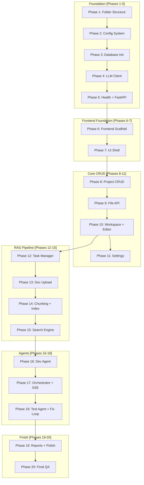

# Ojas: Implementation Plan

| Item | Detail |
|---|---|
| Related documents | All project documents (01 through 08) |
| Team | 4 members |
| Phases | 20 micro-phases, sequential with parallel tracks within each phase |

---

## Overview

This document breaks the entire Ojas build into **20 small, focused micro-phases**. Each phase has a single clear goal, lists exact files to create, implementation details, and a verification checklist. Complete each phase fully before starting the next.

```
Phase 01 → 02 → 03 → 04 → 05 → 06 → 07 → 08 → 09 → 10
Folder    Config  DB     LLM    Health  Frontend  UI      Project  File    Settings
Setup     Loader  Init   Client Check   Scaffold  Shell   CRUD     API     API

Phase 11 → 12 → 13 → 14 → 15 → 16 → 17 → 18 → 19 → 20
Task      Doc    RAG    RAG    Dev     Orchestr  Test    Fix      Reports  Final
Manager   Ingest Index  Search Agent   +SSE      Agent   Loop     +Polish  QA
```

---

---

## Phase 1: Folder Structure & Boilerplate

**Goal:** The complete project directory tree exists. All `__init__.py` files are in place. `.gitignore` and `README.md` are created.

---

### 1.1 Create the Complete Folder Tree

Create every directory and placeholder file. No logic yet — just the skeleton.

**Files to create:**

```
ojas/
├── backend/
│   ├── app/
│   │   ├── __init__.py
│   │   ├── main.py                    ← Empty placeholder
│   │   ├── config.py                  ← Empty placeholder
│   │   ├── api/
│   │   │   ├── __init__.py
│   │   │   └── health.py              ← Empty placeholder
│   │   ├── schemas/
│   │   │   ├── __init__.py
│   │   │   └── common.py              ← Empty placeholder
│   │   ├── tasks/
│   │   │   └── __init__.py
│   │   ├── events/
│   │   │   └── __init__.py
│   │   ├── agents/
│   │   │   ├── __init__.py
│   │   │   └── prompts/
│   │   ├── llm/
│   │   │   ├── __init__.py
│   │   │   ├── client.py              ← Empty placeholder
│   │   │   └── llama_cpp_client.py    ← Empty placeholder
│   │   ├── rag/
│   │   │   └── __init__.py
│   │   ├── validation/
│   │   │   └── __init__.py
│   │   └── storage/
│   │       ├── __init__.py
│   │       └── db.py                  ← Empty placeholder
│   └── tests/
│       ├── __init__.py
│       └── test_health.py             ← Empty placeholder
├── frontend/                           ← Created in Phase 6
├── runtime/                            ← venv created here
├── models/                             ← GGUF file placed here
├── data/                               ← Created at runtime
├── workspace/
├── logs/
├── reports/
├── config/
│   └── settings.json                  ← Created in Phase 2
├── docs/
├── requirements.txt                   ← Empty placeholder
├── start.bat                          ← Empty placeholder
├── .gitignore
└── README.md
```

### 1.2 .gitignore

```
runtime/
models/*.gguf
data/
workspace/
logs/
reports/
frontend/node_modules/
frontend/dist/
__pycache__/
*.pyc
.env
```

### 1.3 README.md

Write a brief placeholder README with project name, one-line description, and a "Setup instructions coming soon" note.

---

### ✅ Phase 1 Verification

| Check | How |
|---|---|
| All directories exist | Inspect folder tree — every directory from the list is present |
| All `__init__.py` files exist | Every Python package directory has `__init__.py` |
| `.gitignore` works | `git status` does not show ignored directories |
| README exists | Open `README.md` — displays project name |

---

---

## Phase 2: Configuration System

**Goal:** `config/settings.json` has default values. `config.py` loads settings with Pydantic. `get_settings()` returns a singleton.

---

### 2.1 Default Settings File

**File:** `config/settings.json`

```json
{
  "model_path": "models/qwen2.5-coder-3b-instruct-q4_k_m.gguf",
  "n_ctx": 4096,
  "n_threads": 4,
  "n_batch": 512,
  "n_gpu_layers": 0,
  "max_tokens": 2048,
  "temperature": 0.2,
  "iteration_limit": 5,
  "test_timeout": 60,
  "host": "127.0.0.1",
  "port": 8000,
  "log_level": "info",
  "theme": "dark"
}
```

### 2.2 Settings Loader

**File:** `backend/app/config.py`

```python
# - Pydantic BaseSettings class: OjasSettings
# - Fields: model_path, n_ctx, n_threads, n_batch, n_gpu_layers,
#           max_tokens, temperature, iteration_limit, test_timeout,
#           host, port, log_level, theme
# - Load from config/settings.json with fallback defaults
# - Singleton access: get_settings()
# - validate model_path exists (warning, not error)
# - validate port range (1024-65535)
```

---

### ✅ Phase 2 Verification

| Check | How |
|---|---|
| Settings file valid | `python -m json.tool config/settings.json` → no errors |
| Config loads | `from backend.app.config import get_settings; s = get_settings(); print(s.port)` → `8000` |
| Singleton works | `get_settings() is get_settings()` → `True` |
| Defaults work | Delete a key from JSON → config still loads with default value |

---

---

## Phase 3: Database Initialization

**Goal:** SQLite database creates all tables on startup. Helper functions work for basic queries.

---

### 3.1 Database Module

**File:** `backend/app/storage/db.py`

```python
# - get_db_path() -> str
#     Returns "data/ojas.db" (resolved relative to project root).
#
# - get_connection() -> sqlite3.Connection
#     Opens connection with WAL mode, foreign keys ON, busy_timeout = 5000.
#
# - init_database() -> None
#     Creates ALL tables from 05_Database_Schema.md if they don't exist:
#       projects, documents, chunks, chunks_fts (FTS5),
#       runs, run_steps, workspace_files,
#       test_cases, test_results, bug_reports, traceability_links
#
# - execute_query(sql, params) -> cursor
# - fetch_one(sql, params) -> dict | None
# - fetch_all(sql, params) -> list[dict]
```

### 3.2 Table Definitions

Implement every table exactly as specified in `05_Database_Schema.md`. Pay attention to:
- UUID4 string primary keys
- ISO 8601 timestamp TEXT columns
- ON DELETE CASCADE for all foreign keys
- FTS5 virtual table for full-text search on chunks

---

### ✅ Phase 3 Verification

| Check | How |
|---|---|
| DB created | Run `init_database()` → `data/ojas.db` file appears |
| All tables exist | `sqlite3 data/ojas.db ".tables"` → lists all expected tables |
| WAL mode | `sqlite3 data/ojas.db "PRAGMA journal_mode"` → `wal` |
| FKs enabled | `sqlite3 data/ojas.db "PRAGMA foreign_keys"` → `1` |
| FTS5 table | `SELECT * FROM chunks_fts` → no error |

---

---

## Phase 4: LLM Client

**Goal:** Abstract LLM interface defined. llama.cpp implementation loads a model, generates text, and streams tokens.

---

### 4.1 Abstract LLM Client

**File:** `backend/app/llm/client.py`

```python
# Abstract base class: LLMClient
# Methods:
#   - generate(prompt: str, max_tokens: int, temperature: float, stop: list[str]) -> str
#   - stream(prompt: str, max_tokens: int, temperature: float, stop: list[str]) -> Iterator[str]
#   - is_loaded() -> bool
#   - get_info() -> dict  (model name, load time, context size)
```

### 4.2 llama.cpp Implementation

**File:** `backend/app/llm/llama_cpp_client.py`

```python
# Concrete implementation using llama-cpp-python
# - Load model once in __init__ from settings.model_path
# - Threading lock for one-generation-at-a-time (thread safety)
# - Implement generate() using create_chat_completion
# - Implement stream() using create_chat_completion with stream=True
# - Track: load_time_seconds, last_error, model_name
# - Handle model-not-found gracefully (log error, is_loaded returns False)
```

### 4.3 Model Download

- Download `qwen2.5-coder-3b-instruct-q4_k_m.gguf` into `models/`.
- Download `bge-small-en-v1.5` embedding model (run fastembed once online).
- Create `requirements.txt` with pinned versions of all Python dependencies.

---

### ✅ Phase 4 Verification

| Check | How |
|---|---|
| Model file exists | `models/qwen2.5-coder-3b-instruct-q4_k_m.gguf` is present |
| Model loads | Instantiate `LlamaCppClient()` → `is_loaded()` returns `True` |
| Generate works | `client.generate("Say hello")` → returns text |
| Stream works | `for token in client.stream("Say hello"): print(token)` → prints tokens |
| Thread safety | Two threads call `generate()` simultaneously → no crash, sequential execution |
| Missing model | Remove model file → `is_loaded()` returns `False`, no crash |

---

---

## Phase 5: Health Endpoint & FastAPI App

**Goal:** FastAPI app starts, loads config, initializes DB, loads LLM, and serves the health endpoint.

---

### 5.1 Common Schema

**File:** `backend/app/schemas/common.py`

```python
# - ErrorResponse: status_code, detail, timestamp
# - SuccessResponse: status, message
```

### 5.2 Health Router

**File:** `backend/app/api/health.py`

```python
# GET /api/health
# Returns JSON:
#   status: "healthy" | "degraded" | "error"
#   model_loaded: bool
#   model_name: str
#   load_time_seconds: float
#   version: str (from package)
#   paths: { workspace, models, data, logs, reports }
#   last_error: str | null
```

### 5.3 FastAPI App Entry Point

**File:** `backend/app/main.py`

```python
# 1. Create FastAPI app instance with metadata (title, version, description)
# 2. Load settings via get_settings()
# 3. Startup event:
#    a. Create data/ directory if not exists
#    b. Initialize SQLite database (init_database())
#    c. Load LLM model (with try/except — don't crash if model missing)
#    d. Log startup info
# 4. Include API router: health
# 5. Add CORS middleware (dev mode: allow localhost:5173)
# 6. Bind to 127.0.0.1 only
# 7. Add exception handlers for common errors
```

### 5.4 First API Test

**File:** `backend/tests/test_health.py`

```python
# - Test GET /api/health returns 200
# - Test response has required fields: status, model_loaded, version
```

---

### ✅ Phase 5 Verification

| Check | How |
|---|---|
| Backend starts | `uvicorn backend.app.main:app --host 127.0.0.1 --port 8000` → no errors |
| Health endpoint | `GET http://127.0.0.1:8000/api/health` → returns JSON with all fields |
| Model status | Health response shows `"model_loaded": true` (or false if model absent) |
| DB created on startup | `data/ojas.db` exists after startup |
| API docs | `GET http://127.0.0.1:8000/docs` → Swagger UI renders |
| Test passes | `pytest backend/tests/test_health.py` → passes |

---

---

## Phase 6: Frontend Scaffold

**Goal:** Vite + React + TypeScript app is created. Dependencies installed. Basic configuration done.

---

### 6.1 Scaffold

**Steps:**
1. Run `npm create vite@latest frontend -- --template react-ts` in the project root.
2. Install all dependencies from `04_Technology_Stack.md` §2.
3. Configure `vite.config.ts` with `/api` proxy to `http://127.0.0.1:8000`.
4. Set up Tailwind CSS.

### 6.2 API Client

**Files to create:**

```
frontend/src/
├── api/
│   ├── client.ts               ← Base fetch wrapper with error handling
│   └── types.ts                ← TypeScript interfaces matching Pydantic schemas
```

**`client.ts` logic:**
- Base URL: `/api`
- Error handling: parse error response, throw typed errors
- Request helper: `apiGet()`, `apiPost()`, `apiPut()`, `apiDelete()`

### 6.3 Monaco Editor Offline Setup

**File:** `frontend/src/monaco/loader.ts`

```typescript
// Configure Monaco Editor for offline loading (no CDN)
// Load workers from local node_modules
// Set up language defaults for Python, JSON, Markdown
```

---

### ✅ Phase 6 Verification

| Check | How |
|---|---|
| Frontend starts | `cd frontend && npm run dev` → Vite dev server on http://localhost:5173 |
| No CDN errors | Browser console shows no failed network requests |
| Proxy works | `fetch('/api/health')` from browser console → returns backend health JSON |
| Monaco loads | Create a test component with Monaco editor → editor renders, no CDN errors |
| TypeScript compiles | `npm run build` → no type errors |

---

---

## Phase 7: UI Shell & Navigation

**Goal:** App shell with navigation bar, 4 route pages (placeholder), model status chip, and theme support.

---

### 7.1 Theme & Providers

**Files to create:**

```
frontend/src/
├── app/
│   ├── theme.ts                ← Light/dark theme tokens from 03_UI_Design.md §8.2
│   ├── providers.tsx           ← QueryClient provider, theme provider
│   └── router.tsx              ← Route definitions (Projects, Workspace, Reports, Settings)
```

### 7.2 Shared Components

**Files to create:**

```
frontend/src/components/shared/
├── AppShell.tsx                ← Top nav bar + sidebar + outlet container
├── StatusChip.tsx              ← Coloured status indicator (green/yellow/red)
└── EmptyState.tsx              ← "Nothing here yet" component with icon and message
```

### 7.3 Placeholder Pages

**Files to create:**

```
frontend/src/pages/
├── ProjectsPage.tsx            ← "Projects" heading + EmptyState
├── WorkspacePage.tsx           ← "Workspace" heading + EmptyState
├── ReportsPage.tsx             ← "Reports" heading + EmptyState
└── SettingsPage.tsx            ← "Settings" heading + EmptyState
```

### 7.4 App Entry Point

**Files to modify:**

```
frontend/src/
├── main.tsx                    ← React DOM render with providers
└── App.tsx                     ← Router setup with AppShell layout
```

**AppShell features:**
- Top navigation bar with Ojas logo and navigation links
- Model status chip that polls `/api/health` every 30 seconds
- Active route highlighting

---

### ✅ Phase 7 Verification

| Check | How |
|---|---|
| App renders | Browser shows app shell with navigation bar |
| Navigation works | Click Projects / Workspace / Reports / Settings → routes change, URL updates |
| Status chip | Shows green if model loaded, red if not |
| Theme tokens | CSS variables are applied (check computed styles) |

---

---

## Phase 8: Project CRUD (Backend + Frontend)

**Goal:** User can create, view, and delete projects. Project list displays in the UI.

---

### 8.1 Backend — Schemas

**File:** `backend/app/schemas/projects.py`

```python
# ProjectCreate: name (str, required), description (str, optional)
# ProjectUpdate: name (str, optional), description (str, optional)
# ProjectResponse: id, name, description, status, created_at, updated_at,
#                  document_count, run_count, test_count
# ProjectListResponse: projects (list[ProjectResponse]), total (int)
```

### 8.2 Backend — Storage

**File:** `backend/app/storage/project_store.py`

```python
# create_project(name, description) -> ProjectResponse
#   - Generate UUID
#   - Create workspace/<project_id>/ directory
#   - Insert into projects table
#   - Return created project
#
# get_project(project_id) -> ProjectResponse | None
#
# list_projects() -> list[ProjectResponse]
#   - Join with aggregate counts (documents, runs, tests)
#
# update_project(project_id, name, description) -> ProjectResponse
#   - Only name and description are editable
#   - Update updated_at timestamp
#
# delete_project(project_id) -> bool
#   - Delete DB records (CASCADE handles related data)
#   - Delete workspace/<project_id>/ directory
#   - Delete reports/<project_id>/ directory
```

### 8.3 Backend — API Router

**File:** `backend/app/api/projects.py`

```python
# Router prefix: /api/projects
#
# GET    /api/projects            → list_projects()
# POST   /api/projects            → create_project()
# GET    /api/projects/{id}       → get_project()
# PATCH  /api/projects/{id}       → update_project()
# DELETE /api/projects/{id}       → delete_project()
```

Register router in `main.py`.

### 8.4 Frontend — Projects Page

**Files to create:**

| File | Implementation |
|---|---|
| `pages/ProjectsPage.tsx` | Full projects page with list and create dialog |
| `components/projects/ProjectCard.tsx` | Card: name, status chip, dates, open/delete buttons |
| `components/projects/NewProjectDialog.tsx` | Modal: name input, description textarea, create button |
| `components/shared/ConfirmDialog.tsx` | Reusable confirmation modal |
| `api/projects.ts` | `listProjects()`, `createProject()`, `deleteProject()`, `getProject()` |

**Logic:**
- Use TanStack Query for data fetching and cache invalidation.
- Project cards in a responsive grid.
- Delete shows confirmation dialog.
- "Open" navigates to `/workspace/<project_id>`.

---

### ✅ Phase 8 Verification

| Check | How |
|---|---|
| Create project | UI → New Project → fill name → project appears in grid |
| List projects | Multiple projects display as cards |
| Delete project | Click delete → confirm → project removed from list |
| Open project | Click Open → navigates to `/workspace/<project_id>` |
| API test | `POST /api/projects` → 201, `GET /api/projects` → list |
| Workspace dir | `workspace/<project_id>/` directory created on project creation |

---

---

## Phase 9: File Management API

**Goal:** Read, write, and delete files within a project workspace. File tree API works. Path traversal attacks are blocked.

---

### 9.1 Backend — Schemas

**File:** `backend/app/schemas/files.py`

```python
# FileNode: name, path, type (file/directory), size, children (list[FileNode] for dirs)
# FileTreeResponse: root (FileNode)
# FileContentResponse: path, content, language, is_generated
# FileSaveRequest: content (str)
```

### 9.2 Backend — Storage

**File:** `backend/app/storage/file_store.py`

```python
# path_is_safe(project_id, file_path) -> bool
#   - Resolve the path, confirm it stays within workspace/<project_id>/
#   - Reject: "..", absolute paths, symlinks outside workspace
#
# get_file_tree(project_id) -> FileNode
#   - Walk workspace/<project_id>/ recursively
#   - Return nested tree structure
#
# read_file(project_id, file_path) -> FileContentResponse
#   - Read content, detect language from extension
#   - Check if file has "# Generated by Ojas" marker
#
# write_file(project_id, file_path, content) -> bool
#   - Create parent directories if needed
#   - Write content to disk
#   - Update timestamp
#
# delete_file(project_id, file_path) -> bool
#   - Delete file from disk
#   - Remove empty parent directories
```

### 9.3 Backend — API Router

**File:** `backend/app/api/files.py`

```python
# Router prefix: /api/projects/{project_id}/files
#
# GET    .../files              → get_file_tree()
# GET    .../files/{path:path}  → read_file()
# PUT    .../files/{path:path}  → write_file()
# DELETE .../files/{path:path}  → delete_file()
```

Register router in `main.py`.

---

### ✅ Phase 9 Verification

| Check | How |
|---|---|
| Create file | `PUT .../files/hello.py` with body → file created in workspace |
| Read file | `GET .../files/hello.py` → returns content |
| File tree | `GET .../files` → returns nested tree with the file |
| Delete file | `DELETE .../files/hello.py` → file removed |
| Path safety | `PUT .../files/../../etc/passwd` → 400 error |
| Nested dirs | `PUT .../files/src/main.py` → creates `src/` directory automatically |

---

---

## Phase 10: Workspace Layout & Editor

**Goal:** Workspace page has the 4-panel layout: sidebar (file tree), editor (Monaco with tabs), run panel, bottom panel. Files open in the editor.

---

### 10.1 Frontend — Workspace Layout

**Files to create:**

| File | Implementation |
|---|---|
| `pages/WorkspacePage.tsx` | Main workspace with resizable panels |
| `components/workspace/Sidebar.tsx` | Left sidebar with tabs: Docs, Code, Tests |
| `components/workspace/FileTree.tsx` | Recursive file tree from API |
| `components/editor/EditorTabs.tsx` | Tabbed interface for open files |
| `components/editor/CodeEditor.tsx` | Monaco editor wrapper |
| `components/workspace/RunPanel.tsx` | Right panel placeholder (prompt box + buttons) |
| `components/workspace/BottomPanel.tsx` | Bottom panel with tabs: Logs, Tests, Bugs, Model |
| `store/uiStore.ts` | Zustand store for UI state (open files, active tab, panel sizes) |

**Logic:**
- Use `react-resizable-panels` for the 4-region layout (sidebar | editor | run panel, bottom panel).
- FileTree fetches from `GET /api/projects/{id}/files`.
- Clicking a file opens it in a new editor tab.
- CodeEditor uses the offline Monaco setup from Phase 6.
- Ctrl+S in the editor saves via `PUT /api/projects/{id}/files/{path}`.
- Unsaved changes indicator (dot) on tabs.

---

### ✅ Phase 10 Verification

| Check | How |
|---|---|
| Layout renders | 4 panels visible: sidebar, editor, run panel, bottom panel |
| Panels resize | Drag dividers → panels resize smoothly |
| File tree | Create files via API → tree shows them |
| Open file | Click file in tree → opens in Monaco editor tab |
| Multiple tabs | Open multiple files → tabs appear, switching works |
| Edit & save | Edit content → Ctrl+S → reload confirms save |
| Unsaved indicator | Edit without saving → dot appears on tab |
| Language detection | Open `.py` file → Python syntax highlighting |

---

---

## Phase 11: Settings API & Page

**Goal:** Settings page shows and edits configuration. Health card displays model status.

---

### 11.1 Backend — Settings API

**Files to create:**

| File | Implementation |
|---|---|
| `schemas/settings.py` | `SettingsResponse`, `SettingsUpdateRequest` |
| `api/settings.py` | `GET /api/settings`, `PUT /api/settings` |

**Logic:**
- GET → return current settings from loaded config.
- PUT → validate new values, update `config/settings.json`, update in-memory config.
- Flag `model_reload_required` if model-related settings changed.

### 11.2 Frontend — Settings Page

**Files to create:**

| File | Implementation |
|---|---|
| `pages/SettingsPage.tsx` | Full settings page |
| `components/settings/SettingsForm.tsx` | Form: model path, context, threads, max tokens, temperature, iteration limit |
| `components/settings/HealthCard.tsx` | Card: model loaded, load time, version, paths, last error |
| `components/settings/ThemeToggle.tsx` | Light / Dark / System toggle |
| `api/settings.ts` | `getSettings()`, `updateSettings()` |

---

### ✅ Phase 11 Verification

| Check | How |
|---|---|
| Settings load | Settings page displays current config values |
| Edit setting | Change temperature to 0.5 → save → verify `settings.json` updated |
| Health card | Shows model loaded status, load time, paths |
| Theme toggle | Switch dark/light → all components update |
| Validation | Enter invalid port (e.g., 99999) → error shown |

---

---

## Phase 12: Background Task Manager & Event Bus

**Goal:** Background tasks run one-at-a-time. SSE event bus streams progress to the frontend.

---

### 12.1 Task Manager

**File:** `backend/app/tasks/task_manager.py`

```python
# Class: TaskManager
#
# - submit(task_fn, run_id) -> bool
#     Submit a callable to run in the background.
#     Only one task at a time. Returns False (409) if busy.
#
# - get_status(run_id) -> TaskStatus
#     Returns: running, completed, failed, cancelled
#
# - cancel(run_id) -> bool
#     Sets a threading Event that the task checks periodically.
#
# - is_busy() -> bool
#     Returns True if a task is currently running.
#
# Implementation: ThreadPoolExecutor(max_workers=1)
```

### 12.2 Event Bus

**File:** `backend/app/events/event_bus.py`

```python
# Class: EventBus
#
# - publish(run_id, event_type, data) -> None
#     Pushes event to all subscribers of this run_id.
#
# - subscribe(run_id) -> AsyncGenerator[dict]
#     Returns an async generator that yields events for the given run_id.
#     Uses asyncio.Queue per subscriber.
#
# - unsubscribe(run_id, subscriber_id) -> None
#     Removes subscriber and cleans up queue.
#
# Event format: { event_type, data, timestamp }
```

### 12.3 SSE Endpoint

**File:** `backend/app/api/sse.py`

```python
# GET /api/runs/{run_id}/events
#   - StreamingResponse with text/event-stream content type
#   - Subscribe to EventBus for run_id
#   - Yield events in SSE format: "data: {json}\n\n"
#   - Handle client disconnect gracefully
```

---

### ✅ Phase 12 Verification

| Check | How |
|---|---|
| Submit task | `task_manager.submit(some_fn, run_id)` → runs in background |
| Busy check | While task running, `is_busy()` → `True` |
| Reject second | Submit while busy → returns `False` |
| Cancel task | `cancel(run_id)` → task stops |
| Event published | `event_bus.publish(run_id, "test", {"msg": "hello"})` → event queued |
| SSE stream | `curl http://localhost:8000/api/runs/{id}/events` → receives events |

---

---

## Phase 13: Document Upload & Parsing

**Goal:** User uploads requirement documents. Files are saved, validated, parsed into plain text.

---

### 13.1 Document Parser

**File:** `backend/app/rag/parser.py`

```python
# parse_document(file_path: str, file_type: str) -> str
#   Routes to the correct parser based on file_type.
#
# parse_docx(file_path: str) -> str
#   Uses python-docx to extract all paragraphs and tables.
#
# parse_pdf(file_path: str) -> str
#   Uses pypdf to extract text page by page.
#
# parse_txt(file_path: str) -> str
#   Plain file read with encoding detection (chardet).
```

### 13.2 Backend — Document APIs

**Files to create:**

| File | Implementation |
|---|---|
| `schemas/documents.py` | `DocumentUploadResponse`, `DocumentListResponse` |
| `storage/document_store.py` | CRUD operations for documents table |
| `api/documents.py` | `POST .../documents` (upload), `GET .../documents` (list), `DELETE .../documents/{id}` |

**Upload flow:**
1. Receive multipart file(s).
2. Validate file type (docx, pdf, txt only).
3. Compute SHA-256 hash.
4. If hash matches existing document → skip (already indexed).
5. Save file to `workspace/<project_id>/documents/`.
6. Insert into `documents` table with status `uploaded`.
7. Return response.

### 13.3 Frontend — Upload Area

**Files to create:**

| File | Implementation |
|---|---|
| `components/workspace/DocsPanel.tsx` | Upload area + document list |
| `components/workspace/UploadArea.tsx` | Drag-and-drop file upload zone |
| `api/documents.ts` | `uploadDocuments()`, `listDocuments()`, `deleteDocument()` |

---

### ✅ Phase 13 Verification

| Check | How |
|---|---|
| Upload PDF | Drag PDF into Docs panel → document appears in list |
| Upload DOCX | Drag DOCX → document appears |
| Upload TXT | Drag TXT → document appears |
| Reject invalid | Upload .exe → error message shown |
| Hash check | Upload same file again → "already exists", no duplicate |
| Parse works | Check logs: text extracted without errors for each format |
| Delete doc | Delete button → document removed from list and disk |

---

---

## Phase 14: Chunking, Embedding & Indexing

**Goal:** Documents are chunked into requirements, embedded, and indexed for semantic + keyword search.

---

### 14.1 Chunker

**File:** `backend/app/rag/chunker.py`

```python
# chunk_document(text: str, document_id: str) -> list[Chunk]
#   Strategy:
#   1. Split by headings (##, ###, numbered sections).
#   2. If a section is > 400 tokens, split further at paragraph boundaries.
#   3. If a section is < 100 tokens, merge with the next section.
#   4. Assign REQ-IDs sequentially: REQ-001, REQ-002, ...
#   5. Each chunk gets: id, req_id, heading, content, token_count, chunk_index.
#
# chunk_code(file_path: str, source_code: str) -> list[CodeChunk]
#   Uses ast.parse to split Python code into function/class chunks.
#   Each chunk gets: symbol_name, symbol_type, content, start_line, end_line.
```

### 14.2 Embedder

**File:** `backend/app/rag/embedder.py`

```python
# Class: Embedder
# - __init__(): Load fastembed TextEmbedding("BAAI/bge-small-en-v1.5")
# - embed_texts(texts: list[str]) -> list[list[float]]
# - embed_single(text: str) -> list[float]
#
# Singleton pattern: loaded once at startup, reused.
# Embedding dimension: 384 (bge-small-en-v1.5).
```

### 14.3 Index Manager

**File:** `backend/app/rag/index.py`

```python
# Class: IndexManager
#
# - __init__(project_id):
#     Initialize Chroma PersistentClient(path="data/chroma").
#     Get or create collections: 'requirements', 'code'.
#
# - index_document(document_id, chunks):
#     1. Delete old chunks for this document_id from SQLite and Chroma.
#     2. Insert new chunks into SQLite (chunks table).
#     3. Embed chunk texts via Embedder.
#     4. Upsert embeddings + metadata into Chroma 'requirements' collection.
#     5. Update FTS5 index.
#     6. Update document status to 'indexed'.
#
# - index_code(file_path, code_chunks):
#     1. Delete old code chunks for this file from SQLite and Chroma.
#     2. Insert into code_chunks table.
#     3. Embed and upsert into Chroma 'code' collection.
#
# - rebuild_chroma():
#     Read all chunks from SQLite, re-embed, re-insert into Chroma.
#
# Chroma config:
#   Settings(anonymized_telemetry=False)
```

### 14.4 Indexing API & Trigger

**Files to create/modify:**

| File | Implementation |
|---|---|
| `api/documents.py` (update) | Add `POST .../index` endpoint |
| `schemas/documents.py` (update) | Add `RequirementChunkResponse` |
| `api/requirements_api.py` | `GET .../requirements` (list chunks with REQ-IDs) |

**Index trigger — `POST .../index`:**
1. Create a background task via TaskManager.
2. For each document with status `uploaded` or hash changed:
   a. Parse document text.
   b. Chunk into requirements.
   c. Embed chunks.
   d. Index into SQLite + Chroma.
   e. Update document status to `indexed`.
3. Publish SSE events: `stage: indexing`, `file: <filename>`, `done`.

### 14.5 Frontend — Requirement List

**Files to create:**

| File | Implementation |
|---|---|
| `components/workspace/RequirementList.tsx` | Expandable list of REQ-IDs with snippets |
| `api/documents.ts` (update) | Add `listRequirements()`, `triggerIndex()` |

---

### ✅ Phase 14 Verification

| Check | How |
|---|---|
| Chunks created | `GET .../requirements` → returns REQ-ID chunks with content |
| Correct REQ-IDs | Chunks numbered REQ-001, REQ-002, etc. |
| Embeddings exist | Chroma collection has entries matching chunk count |
| FTS5 populated | `SELECT * FROM chunks_fts WHERE chunks_fts MATCH 'some term'` → results |
| Hash skip | Re-index same document → "already indexed", no reprocessing |
| Changed file | Modify and re-upload → old chunks removed, new chunks indexed |
| UI shows chunks | Requirement list displays REQ-IDs with expandable content |

---

---

## Phase 15: RAG Search Engine

**Goal:** Hybrid search (semantic + keyword + RRF fusion) returns relevant requirement chunks for any query.

---

### 15.1 Search Engine

**File:** `backend/app/rag/search.py`

```python
# Class: SearchEngine
#
# - search(project_id, query, top_k=6, collection='requirements') -> list[SearchResult]
#     1. Semantic search:
#        - Embed query via Embedder.
#        - Query Chroma collection → top 2*k results with distance scores.
#     2. Keyword search:
#        - FTS5 query on chunks_fts → top 2*k results with BM25 rank.
#     3. Reciprocal Rank Fusion:
#        score(doc) = sum(1 / (k + rank)) for each list the doc appears in.
#        k = 60 (standard RRF constant).
#     4. Return top_k merged results.
#
# SearchResult: chunk_id, req_id, heading, content, score, source (semantic/keyword/both)
```

### 15.2 Search API

**File:** `backend/app/api/search.py`

```python
# GET /api/projects/{project_id}/search?q=<query>&top_k=6
#   Returns list of SearchResult
```

---

### ✅ Phase 15 Verification

| Check | How |
|---|---|
| Semantic works | Search "add a new book" → returns book-related requirement chunks |
| Keyword works | Search exact term from document → FTS5 returns results |
| RRF merge | Results include both semantic and keyword matches, sorted by fused score |
| Top-k respected | Request top_k=3 → exactly 3 results returned |
| Empty query | Empty search → returns empty list or top chunks |
| No results | Search for gibberish → empty results, no error |

---

---

## Phase 16: Development Agent & Code Generation

**Goal:** User enters a prompt → Development Agent analyzes requirements → generates a plan → user approves → code files are generated with static checks.

---

### 16.1 Prompt Templates

**Directory:** `backend/app/agents/prompts/`

| File | Purpose |
|---|---|
| `requirement_analysis.txt` | System prompt for analyzing requirements and creating a structured summary |
| `development_plan.txt` | System prompt for creating a module/file/order plan from requirements |
| `code_generation.txt` | System prompt for generating one Python file at a time |
| `code_fix.txt` | System prompt for fixing a specific function given a bug report |

**Prompt design principles:**
- Each prompt includes: system message (role + rules), retrieved requirement chunks, and user instruction.
- Output format is specified (JSON for plan, Python code in code blocks).
- Keep total prompt under 3000 tokens to leave room for generation.
- Include examples of expected output format.

### 16.2 Development Agent

**File:** `backend/app/agents/development_agent.py`

```python
# Class: DevelopmentAgent
#
# - __init__(llm_client, search_engine, project_id)
#
# - analyze_requirements(prompt: str) -> RequirementAnalysis:
#     1. Retrieve top requirements relevant to the prompt.
#     2. Build prompt with requirement_analysis template.
#     3. Generate → parse structured analysis (modules, entities, relationships).
#
# - generate_plan(prompt: str, analysis: RequirementAnalysis) -> DevelopmentPlan:
#     1. Build prompt with development_plan template + analysis.
#     2. Generate → parse plan (list of files, order, description of each).
#     3. Return plan for user review.
#
# - generate_file(file_spec: FileSpec, plan: DevelopmentPlan) -> GeneratedFile:
#     1. Retrieve requirements relevant to this specific file/module.
#     2. Build prompt with code_generation template + requirements + plan context.
#     3. Generate → extract Python code from response.
#     4. Return file path + content.
#
# - fix_function(bug_report: BugReport, current_code: str) -> str:
#     1. Retrieve the linked requirement.
#     2. Build prompt with code_fix template + bug details + current code.
#     3. Generate → extract fixed function code.
#     4. Return fixed code.
#
# Helper methods:
# - _extract_code_block(response: str) -> str: Parse ```python blocks from LLM output.
# - _build_context(chunks: list) -> str: Format retrieved chunks into prompt context.
```

### 16.3 Static Checker

**File:** `backend/app/validation/static_check.py`

```python
# check_syntax(code: str, file_path: str) -> CheckResult:
#     Try ast.parse(code). Return pass/fail with error details.
#
# check_lint(file_path: str) -> CheckResult:
#     Run ruff as subprocess on the file.
#     Parse output for errors (not warnings).
#     Return pass/fail with issues list.
#
# check_file(code: str, file_path: str) -> CheckResult:
#     Run check_syntax then check_lint.
#     If syntax fails, don't run lint.
#     Return combined result.
#
# CheckResult: passed (bool), issues (list of {line, col, code, message})
```

**Self-correction loop (within Development Agent):**
1. Generate code.
2. Run `check_file()`.
3. If failed: append errors to prompt, re-generate (max 2 retries).
4. If still failed after retries: save file with errors noted, continue.

---

### ✅ Phase 16 Verification

| Check | How |
|---|---|
| Requirement analysis | Call `analyze_requirements("build a calculator")` → structured analysis returned |
| Plan generation | Call `generate_plan(...)` → plan with file list returned |
| Code generation | Call `generate_file(...)` → Python file content returned |
| Code block extraction | Response with ` ```python...``` ` → code extracted correctly |
| Syntax check | Valid Python → passes. `def foo(` → fails with error details |
| Lint check | Clean code → passes. Unused import → fails with ruff error |
| Self-correction | Generate code with error → agent retries and fixes (check logs) |

---

---

## Phase 17: Orchestrator, Runs API & Run Panel

**Goal:** Full plan → develop workflow runs as a background task with SSE progress. User can approve plans and cancel runs.

---

### 17.1 Orchestrator — Plan & Develop

**File:** `backend/app/orchestrator.py`

```python
# Class: Orchestrator
#
# - __init__(llm_client, search_engine, task_manager, event_bus)
#
# - run_plan(project_id, prompt) -> RunResult:
#     1. Publish event: stage=planning, status=started.
#     2. Create DevelopmentAgent.
#     3. Analyze requirements.
#     4. Generate development plan.
#     5. Save plan to runs table (plan_text).
#     6. Publish event: stage=planning, status=completed.
#     7. Wait for user approval (plan status = pending_approval).
#
# - run_develop(project_id, prompt, plan) -> RunResult:
#     1. If no approved plan exists, run plan first.
#     2. For each file in the plan (in order):
#        a. Publish event: stage=generating, file=<path>.
#        b. Generate file via DevelopmentAgent.
#        c. Run static checks.
#        d. If checks fail: self-correct (up to 2 retries).
#        e. Write file to workspace.
#        f. Index code chunks.
#        g. Publish event: file=<path>, status=created, check_result.
#     3. Publish event: stage=generating, status=completed.
#
# Cancel check: between each file, check if cancel was requested.
#
# State machine:
#   IDLE → PLANNING → PLAN_REVIEW → GENERATING → CHECKING → DONE/FAILED
```

### 17.2 Backend — Runs API

**Files to create:**

| File | Implementation |
|---|---|
| `schemas/runs.py` | `RunCreateRequest`, `RunResponse`, `RunDetailResponse`, `RunStepResponse` |
| `storage/run_store.py` | `save_run()`, `update_run()`, `save_run_step()`, `get_run_history()` |
| `api/runs.py` | `POST .../runs` (start), `GET .../runs` (history), `GET /api/runs/{id}` (detail), `POST /api/runs/{id}/cancel` |
| `api/plan.py` | `GET .../plan` (get plan), `POST .../plan/approve` (approve + proceed) |

### 17.3 Frontend — Run Panel & SSE

**Files to create:**

| File | Implementation |
|---|---|
| `components/workspace/RunPanel.tsx` (update) | Full run panel: prompt box, Start button, status display, stage stepper |
| `components/workspace/StageStepper.tsx` | Visual stepper: Index → Plan → Generate → Check → Test → Fix → Done |
| `components/workspace/PlanReview.tsx` | Show plan text, allow editing, Approve/Reject buttons |
| `components/workspace/LogView.tsx` | Live log display with timestamps in bottom panel |
| `api/runs.ts` | `startRun()`, `cancelRun()`, `listRuns()`, `getRunDetail()` |
| `api/sse.ts` | `subscribeToEvents(runId)` → EventSource wrapper with reconnect |
| `store/runStore.ts` | Zustand store for current run state (stage, file, iteration, events) |

**SSE integration:**
1. When a run starts, open EventSource to `GET /api/runs/{id}/events`.
2. On each event, update the Zustand run store.
3. Components subscribe to store slices they need (RunPanel → stage, LogView → events).
4. On `done` event, invalidate TanStack Query caches (files, runs, etc.).

---

### ✅ Phase 17 Verification

| Check | How |
|---|---|
| Start run | Enter prompt → click Start → run begins |
| Plan generated | Plan appears in PlanReview component |
| Plan edit | Edit plan text → Approve → modified plan used for generation |
| Code generation | Files appear in workspace one by one |
| SSE events | Run panel shows live progress: stage, current file |
| Log view | Bottom panel Logs tab shows timestamped events |
| Cancel | Click Stop during generation → run stops cleanly |
| File tree updates | After generation, tree shows new files |
| Edit generated code | Open generated file in Monaco → edit → save works |
| Static checks | Each file passes ast.parse and ruff (check logs) |

---

---

## Phase 18: Testing Agent, Bug Reports & Fix Loop

**Goal:** Tests execute with pytest, failures produce structured bug reports. Automated fix loop runs with 3 stop rules.

---

### 18.1 Test Runner

**File:** `backend/app/validation/test_runner.py`

```python
# Class: TestRunner
#
# - run_tests(project_id: str, test_timeout: int = 60) -> TestRunResult:
#     1. Determine workspace path: workspace/<project_id>/
#     2. Find all pytest files (test_*.py or *_test.py).
#     3. Run pytest as subprocess:
#        subprocess.run(
#            [sys.executable, "-m", "pytest", "--tb=short", "--junitxml=result.xml", "-v"],
#            cwd=workspace_path,
#            timeout=test_timeout,
#            capture_output=True
#        )
#     4. Parse the JUnit XML report.
#     5. Return per-test results: tc_id, name, result, duration, error_message.
#
# - parse_junit_xml(xml_path: str) -> list[TestCaseResult]:
#     Parse <testcase> elements, extract name, time, <failure>/<error> messages.
```

### 18.2 Testing Agent

**File:** `backend/app/agents/testing_agent.py`

```python
# Class: TestingAgent
#
# - __init__(llm_client, search_engine, project_id)
#
# - analyze_failures(test_results, code_chunks, requirements) -> list[BugReport]:
#     For each failed test:
#     1. Find the linked requirement (from tc_id → req_id mapping or search).
#     2. Find the relevant code chunk (from file_path + function_name).
#     3. Build prompt with bug_analysis template:
#        "Given this requirement, this code, and this test failure,
#         fill in: probable_cause, severity."
#     4. Generate → parse structured bug report.
#     5. Assign bug_id: B-001, B-002, ...
#
# Bug report fields filled by LLM: probable_cause, severity
# Bug report fields filled by code: bug_id, req_id, tc_id, file_path,
#                                   function_name, expected_result, actual_result
```

**Prompt template:** `backend/app/agents/prompts/bug_analysis.txt`

### 18.3 Test Case & Bug Report Management

**Files to create:**

| File | Implementation |
|---|---|
| `schemas/tests.py` | `TestCaseResponse`, `TestResultResponse`, `TestCaseListResponse` |
| `storage/test_store.py` | CRUD for test_cases and test_results tables |
| `api/tests.py` | `POST .../tests` (upload), `GET .../tests` (list), `GET .../tests/{id}/results` |
| `schemas/bugs.py` | `BugReportResponse`, `BugListResponse` |
| `storage/bug_store.py` | CRUD for bug_reports table |
| `api/bugs.py` | `GET .../bugs` (list), `GET .../bugs/{id}` (detail) |

**Test upload flow:**
1. Receive pytest file(s) via multipart upload.
2. Save to `workspace/<project_id>/tests/`.
3. Parse file with `ast` to extract test function names.
4. Assign TC-IDs: TC-001, TC-002, ...
5. Insert into `test_cases` table.

### 18.4 Fix Loop Controller

**Add to `orchestrator.py`:**

```python
# - run_test(project_id) -> RunResult:
#     1. Publish event: stage=testing, status=started.
#     2. Load test cases for the project.
#     3. Run TestRunner.run_tests().
#     4. Save test results to SQLite.
#     5. If failures exist:
#        a. Create TestingAgent.
#        b. Analyze failures → generate bug reports.
#        c. Save bug reports to SQLite.
#     6. Publish events: test results, bug reports.
#     7. Publish event: stage=testing, status=completed.
#
# - run_fix_loop(project_id, iteration_limit=5) -> RunResult:
#     iteration = 0
#     previous_failures = set()
#
#     while iteration < iteration_limit:
#         iteration += 1
#         Publish event: iteration=iteration, limit=iteration_limit.
#
#         # 1. Run tests
#         test_results = TestRunner.run_tests(project_id)
#         failures = [t for t in test_results if t.result == 'failed']
#
#         # 2. Stop rule: all tests pass
#         if not failures:
#             Publish event: done, stop_reason=all_passed.
#             return RunResult(success=True, stop_reason='all_passed')
#
#         # 3. Stop rule: same failure repeats
#         current_failure_set = {(f.tc_id, f.error_message) for f in failures}
#         if current_failure_set == previous_failures:
#             Publish event: done, stop_reason=repeated_failure.
#             Escalate to user.
#             return RunResult(success=False, stop_reason='repeated_failure')
#         previous_failures = current_failure_set
#
#         # 4. Generate bug reports
#         bug_reports = TestingAgent.analyze_failures(failures, ...)
#         Save bug reports to DB.
#
#         # 5. Fix each failing function
#         for bug in bug_reports:
#             Publish event: stage=fixing, file=bug.file_path, function=bug.function_name.
#             fixed_code = DevelopmentAgent.fix_function(bug, current_code)
#             Apply fix to file.
#             Run static checks on fixed file.
#             Publish event: file=bug.file_path, status=fixed.
#
#         # 6. Check cancel
#         if cancel_requested:
#             return RunResult(success=False, stop_reason='user_cancelled')
#
#     # 7. Stop rule: iteration limit
#     Publish event: done, stop_reason=iteration_limit.
#     return RunResult(success=False, stop_reason='iteration_limit')
#
# - run_full(project_id, prompt) -> RunResult:
#     """Complete workflow: index → plan → generate → test → fix loop."""
#     1. Index documents (if not already indexed).
#     2. Generate plan → wait for user approval.
#     3. Generate code files (with static checks).
#     4. Run fix loop (test → bug report → fix → re-test).
#     5. Generate consolidated report.
#     6. Return final result.
```

### 18.5 Frontend — Tests, Bugs & Fix Loop UI

**Files to create:**

| File | Implementation |
|---|---|
| `components/workspace/TestsPanel.tsx` | Sidebar tab: list test cases, upload area |
| `components/workspace/TestResultsTable.tsx` | Bottom panel tab: TC-ID, name, result (pass/fail icon), duration |
| `components/workspace/BugList.tsx` | Bottom panel tab: bug reports with severity, REQ-ID, TC-ID, cause |
| `components/workspace/IterationStatus.tsx` | Shows: iteration N/5, failing tests count, fix applied |
| `components/workspace/EscalationBanner.tsx` | "Fix loop stopped: same failure repeated." with link to code |
| `components/editor/DiffEditorView.tsx` | Monaco DiffEditor for accept/reject generated changes |
| `api/tests.ts` | `uploadTests()`, `listTests()`, `getTestResults()` |
| `api/bugs.ts` | `listBugs()`, `getBugDetail()` |

**Interactions:**
- Click a test result row → open the test file at the test function.
- Click a bug report → open the source file at the failing function.
- Click REQ-ID in a bug → show the requirement chunk.
- Fix loop button in RunPanel with iteration counter.
- SSE events for iteration, bug, done (with stop_reason).

---

### ✅ Phase 18 Verification

| Check | How |
|---|---|
| Upload tests | Drag test file into Tests panel → test cases listed with TC-IDs |
| Run tests | Click Test → pytest runs → results appear in bottom panel |
| Pass/fail correct | Results match actual pytest output (not LLM prediction) |
| Bug reports | Failed tests produce structured bug reports with all fields |
| Traceability | Bug report shows REQ-ID, TC-ID, file, function |
| Bug → code | Click bug report → editor opens at the failing function |
| Diff view | Generated code changes shown in Monaco DiffEditor |
| Fix loop starts | Click Fix Loop → iterations begin |
| Stop: all pass | All tests pass → "All tests passed!" message |
| Stop: limit | Set limit to 2 → stops at iteration 2 |
| Stop: repeat | Same failure twice → escalation banner shown |
| Cancel | Click Stop during fix loop → loop stops cleanly |
| End-to-end | Upload docs → prompt → plan → generate → test → fix → done |

---

---

## Phase 19: Traceability, Reports & UI Polish

**Goal:** Traceability links work. Reports page complete. Token streaming. Loading states, toasts, and polished UX.

---

### 19.1 Traceability Links

**File:** `backend/app/storage/traceability.py`

```python
# link_req_to_code(project_id, req_id, code_chunk_id)
# link_req_to_test(project_id, req_id, test_case_id)
# link_test_to_bug(project_id, test_case_id, bug_report_id)
#
# get_coverage(project_id) -> list[CoverageItem]:
#     For each requirement:
#       - Which code symbols implement it.
#       - Which test cases test it.
#       - Which test results (pass/fail).
#       - Any open bugs.
```

### 19.2 Report Generator

**File:** `backend/app/storage/report_writer.py`

```python
# Class: ReportWriter
#
# - generate_development_plan_report(project_id, plan) -> str
# - generate_bug_report(project_id, bugs) -> str
# - generate_test_report(project_id, results) -> str
# - generate_consolidated_report(project_id) -> str:
#     1. Summary: total tests, passed, failed, iterations, time.
#     2. Requirement coverage table:
#        REQ-ID | Heading | Test Cases | Results | Bugs
#     3. Bug history.
#     4. Run history.
#     Save to reports/<project_id>/consolidated_report.md
#
# All reports saved to reports/<project_id>/ directory.
```

### 19.3 Reports API

**Files to create:**

| File | Implementation |
|---|---|
| `schemas/reports.py` | `ReportListResponse`, `ReportDetailResponse` |
| `api/reports.py` | `GET .../reports` (list), `GET .../reports/{name}` (download) |

### 19.4 Frontend — Reports Page

**Files to create:**

| File | Implementation |
|---|---|
| `pages/ReportsPage.tsx` | Full reports page with project selector |
| `components/reports/ReportSummary.tsx` | Summary bar: tests count, pass/fail, iterations, time |
| `components/reports/CoverageTable.tsx` | Requirement → test cases → results mapping |
| `components/reports/ReportViewer.tsx` | Markdown renderer for report content |
| `components/reports/RunHistory.tsx` | List of past runs with type, status, time |
| `api/reports.ts` | `listReports()`, `getReport()`, `downloadReport()` |

### 19.5 Token Streaming

**Backend:**
- Update `LLMClient.stream()` to yield tokens one at a time.
- In orchestrator: when generating, publish `token` SSE events.
- Rate-limit token events (batch every ~100ms to avoid flooding).

**Frontend:**
- `components/workspace/ModelOutput.tsx` — bottom panel tab showing streamed raw model text.
- Append tokens as they arrive from SSE.
- Auto-scroll with pause button.

### 19.6 Editor Enhancements

**Files to create/modify:**

| File | Implementation |
|---|---|
| `components/editor/DiffEditorView.tsx` (update) | Accept/Reject buttons above diff editor |
| `components/editor/RequirementBadge.tsx` | Small REQ-ID label above functions. Click → show requirement |
| `components/editor/ReadOnlyBanner.tsx` | "Model is writing this file" banner when file is being generated |

**Logic:**
- During generation: file being generated is read-only in the editor.
- After generation: file shows in diff view (old vs new) with Accept/Reject.
- Accept → file saved. Reject → reverted to previous version.

### 19.7 UI Polish

| Item | Implementation |
|---|---|
| **Loading states** | Skeleton loaders for projects, file tree, reports. Spinner for model loading |
| **Empty states** | "Upload a document to begin", "No test cases yet", "No reports generated" |
| **Error handling** | Toast notifications for errors. Retry buttons. Error boundaries |
| **Theme** | Dark/light mode with CSS variables from `03_UI_Design.md` §8.2 |
| **Toasts** | Lightweight toast component for success/error/info messages |
| **Unsaved indicator** | Dot on editor tab when file has unsaved changes |
| **Keyboard shortcuts** | Ctrl+S save, Esc close dialogs, keyboard navigation |
| **Backend disconnected banner** | Full-width "Backend not reachable" with retry |
| **Responsive panels** | Min/max sizes on resizable panels. Collapse sidebar button |

### 19.8 start.bat

Create `start.bat` per `08_Setup_Guide.md` §7.3:
- Activate virtual environment
- Start Uvicorn backend
- Open browser to `http://127.0.0.1:8000`

---

### ✅ Phase 19 Verification

| Check | How |
|---|---|
| Traceability | REQ-001 → linked to add_book() → linked to TC-001 → linked to B-001 |
| Reports page | Shows summary, coverage table, report content |
| Coverage table | Each REQ-ID shows linked tests and results. Uncovered highlighted |
| Download report | Click download → Markdown file downloaded |
| Token streaming | Model output tab shows text appearing character by character |
| Loading states | Slow-load scenarios show skeletons, not blank pages |
| Error handling | Kill backend → "Backend not reachable" banner appears |
| Theme toggle | Switch dark/light → all components update correctly |
| REQ badges | Functions show REQ-ID label. Click → shows requirement |
| start.bat | Double-click → Uvicorn starts, browser opens |

---

---

## Phase 20: Integration Testing, Sample Projects & Final QA

**Goal:** All acceptance criteria pass. Platform is stable and demo-ready.

---

### 20.1 Sample Projects for Testing

Create 3 sample projects with requirement documents and test cases:

| # | Project | Complexity | Documents |
|---|---|---|---|
| 1 | **Calculator** | Simple | 5 requirements (add, subtract, multiply, divide, history) |
| 2 | **Library System** | Medium | 10 requirements (add/remove books, members, issuing, returns, search) |
| 3 | **Student Grade Manager** | Medium | 8 requirements (students, courses, grades, GPA calculation, reports) |

Each project has:
- A requirement document (`.txt` or `.docx`).
- 5–10 pytest test cases.
- Expected output (what a passing project looks like).

### 20.2 Performance Metrics

**File:** `backend/app/metrics.py`

```python
# Record and report:
# - Tokens per second (per generation call and average)
# - Time per stage (indexing, planning, generating, testing, fixing)
# - Peak RAM usage (psutil.Process().memory_info().rss)
# - Fix loop iterations per project
# - Retrieval metrics: Recall@k and MRR (if ground truth available)
#
# Write to logs/metrics.json after each run.
```

### 20.3 Acceptance Criteria Testing

| # | Criterion | Test Procedure |
|---|---|---|
| AC-1 | Offline startup | Disable network → `start.bat` → full cycle works |
| AC-2 | RAG retrieval | Index sample doc → query → verify relevant chunks returned |
| AC-3 | Dev Agent generates valid code | Generate Calculator project → all files pass ast.parse + ruff |
| AC-4 | Test Agent produces bug reports | Run tests on a buggy project → bug reports have REQ-ID, TC-ID, all fields |
| AC-5 | Fix loop stop rules | Test each rule: all pass, iteration limit, repeated failure |
| AC-6 | 2/3 projects pass all tests | Run all 3 sample projects → at least 2 reach all tests passing |
| AC-7 | Consolidated report | Report shows requirement coverage table with pass/fail per test |
| AC-8 | Metrics recorded | Check logs: tokens/s, time/stage, RAM, iterations, Recall@k, MRR |

### 20.4 Bug Fix Priorities

| Priority | Category |
|---|---|
| 1 - Critical | App crashes, data loss, infinite loops, model doesn't load |
| 2 - High | Wrong test results, broken file save, SSE disconnects permanently |
| 3 - Medium | UI glitches, slow performance, missing error messages |
| 4 - Low | Polish: alignment, colours, typos, edge case formatting |

### 20.5 Final Checklist

| Item | Status |
|---|---|
| All acceptance criteria pass | ☐ |
| Offline mode verified (network disabled) | ☐ |
| `start.bat` works on a clean machine (after setup) | ☐ |
| No CDN references in frontend build | ☐ |
| No telemetry in Chroma or any library | ☐ |
| No outbound network calls in backend | ☐ |
| README has clear setup instructions | ☐ |
| Settings page shows correct health info | ☐ |
| Reports download correctly as Markdown | ☐ |
| File API rejects path traversal attempts | ☐ |
| Generated code runs only in workspace with timeout | ☐ |
| Logs capture all operations with timestamps | ☐ |
| At least 2/3 sample projects pass end-to-end | ☐ |
| Metrics recorded for all runs | ☐ |

### 20.6 Documentation Update

| Document | Update needed |
|---|---|
| `README.md` | Final setup instructions, usage guide, screenshots |
| `requirements.txt` | Pin exact working versions |
| `package.json` | Pin exact working versions |
| `config/settings.json` | Verified default values |
| All docs (01–08) | Any design changes made during implementation |

---

### ✅ Phase 20 Verification

| Check | How |
|---|---|
| Calculator project | Upload → generate → test → all pass (no fix loop needed) |
| Library project | Upload → generate → test → fix loop → all pass within 5 iterations |
| Student Grade project | Upload → generate → test → fix loop → most tests pass |
| Offline | Full test with network disabled |
| Clean machine | Setup from scratch on a teammate's machine |
| Demo | 10-minute walkthrough: create project → upload → generate → test → report |

---

---

## Appendix A: File Creation Order (All Phases)

### Phase 1–5 (Foundation)
```
1.  All directories + __init__.py files
2.  .gitignore
3.  README.md
4.  config/settings.json
5.  backend/app/config.py
6.  backend/app/storage/db.py
7.  backend/app/llm/client.py
8.  backend/app/llm/llama_cpp_client.py
9.  requirements.txt
10. backend/app/schemas/common.py
11. backend/app/api/health.py
12. backend/app/main.py
13. backend/tests/test_health.py
```

### Phase 6–7 (Frontend Foundation)
```
14. frontend/ (Vite scaffold)
15. frontend/src/monaco/loader.ts
16. frontend/src/api/client.ts + types.ts
17. frontend/src/app/theme.ts
18. frontend/src/app/providers.tsx
19. frontend/src/app/router.tsx
20. frontend/src/components/shared/AppShell.tsx
21. frontend/src/components/shared/StatusChip.tsx
22. frontend/src/components/shared/EmptyState.tsx
23. frontend/src/pages/* (placeholders)
24. frontend/src/main.tsx + App.tsx
```

### Phase 8–11 (Core CRUD & UI)
```
25. backend/app/schemas/projects.py
26. backend/app/storage/project_store.py
27. backend/app/api/projects.py
28. frontend/src/api/projects.ts
29. frontend/src/pages/ProjectsPage.tsx (full)
30. frontend/src/components/projects/*
31. backend/app/schemas/files.py
32. backend/app/storage/file_store.py
33. backend/app/api/files.py
34. frontend/src/pages/WorkspacePage.tsx (full layout)
35. frontend/src/components/workspace/FileTree.tsx
36. frontend/src/components/editor/CodeEditor.tsx + EditorTabs.tsx
37. frontend/src/store/uiStore.ts
38. backend/app/schemas/settings.py
39. backend/app/api/settings.py
40. frontend/src/pages/SettingsPage.tsx
41. frontend/src/components/settings/*
```

### Phase 12–15 (Task Manager & RAG)
```
42. backend/app/tasks/task_manager.py
43. backend/app/events/event_bus.py
44. backend/app/api/sse.py
45. backend/app/rag/parser.py
46. backend/app/schemas/documents.py
47. backend/app/storage/document_store.py
48. backend/app/api/documents.py
49. frontend/src/api/documents.ts
50. frontend/src/components/workspace/DocsPanel.tsx
51. frontend/src/components/workspace/UploadArea.tsx
52. backend/app/rag/chunker.py
53. backend/app/rag/embedder.py
54. backend/app/rag/index.py
55. backend/app/api/requirements_api.py
56. frontend/src/components/workspace/RequirementList.tsx
57. backend/app/rag/search.py
58. backend/app/api/search.py
```

### Phase 16–17 (Dev Agent & Orchestration)
```
59. backend/app/agents/prompts/*.txt
60. backend/app/agents/development_agent.py
61. backend/app/validation/static_check.py
62. backend/app/orchestrator.py (plan + develop)
63. backend/app/schemas/runs.py
64. backend/app/storage/run_store.py
65. backend/app/api/runs.py
66. backend/app/api/plan.py
67. frontend/src/api/runs.ts + sse.ts
68. frontend/src/store/runStore.ts
69. frontend/src/components/workspace/RunPanel.tsx (full)
70. frontend/src/components/workspace/StageStepper.tsx
71. frontend/src/components/workspace/PlanReview.tsx
72. frontend/src/components/workspace/LogView.tsx
```

### Phase 18 (Test Agent & Fix Loop)
```
73. backend/app/validation/test_runner.py
74. backend/app/agents/prompts/bug_analysis.txt
75. backend/app/agents/testing_agent.py
76. backend/app/schemas/tests.py + bugs.py
77. backend/app/storage/test_store.py + bug_store.py
78. backend/app/api/tests.py + bugs.py
79. backend/app/orchestrator.py (+ test flow + fix loop)
80. frontend/src/api/tests.ts + bugs.ts
81. frontend/src/components/workspace/TestsPanel.tsx
82. frontend/src/components/workspace/TestResultsTable.tsx
83. frontend/src/components/workspace/BugList.tsx
84. frontend/src/components/workspace/IterationStatus.tsx
85. frontend/src/components/workspace/EscalationBanner.tsx
86. frontend/src/components/editor/DiffEditorView.tsx
```

### Phase 19 (Reports & Polish)
```
87. backend/app/storage/traceability.py
88. backend/app/storage/report_writer.py
89. backend/app/schemas/reports.py
90. backend/app/api/reports.py
91. frontend/src/pages/ReportsPage.tsx
92. frontend/src/components/reports/*
93. frontend/src/components/workspace/ModelOutput.tsx
94. frontend/src/components/editor/RequirementBadge.tsx
95. frontend/src/components/editor/ReadOnlyBanner.tsx
96. start.bat
97. UI polish: toasts, skeletons, empty states, error boundaries
```

### Phase 20 (Final QA)
```
98.  test_projects/ (3 sample projects)
99.  backend/app/metrics.py
100. Integration tests
101. Bug fixes
102. README.md (final)
103. Documentation updates
```

---

## Appendix B: Dependency Graph



---

## Appendix C: Risk Mitigation per Phase

| Phase | Key Risk | Mitigation |
|---|---|---|
| 1–3 | Database schema mismatch with docs | Cross-reference every table with `05_Database_Schema.md` |
| 4 | llama-cpp-python build fails on Windows | Use pre-built wheels; document exact compiler setup |
| 5 | FastAPI startup crash if model missing | Graceful degradation — health shows "degraded" |
| 6 | Monaco offline config is tricky | Test offline mode immediately; have CodeMirror as backup |
| 8–9 | Path traversal vulnerability | Write tests specifically for `../../` attacks |
| 13 | Document parsing fails for complex PDFs | Test with real documents early; fallback to raw text |
| 14 | Chunking quality affects everything | Test with real documents; tune chunk sizes (100–400 tokens) |
| 15 | Search returns irrelevant results | Tune RRF constant k; compare semantic-only vs hybrid |
| 16 | LLM generates unparseable code | Strong output format instructions; self-correction loop; ast.parse |
| 17 | SSE disconnects on long runs | Reconnect logic in frontend; heartbeat events from backend |
| 18 | pytest subprocess hangs | Strict timeout; kill process tree on timeout |
| 18 | Fix loop doesn't converge | 3 stop rules guarantee termination; repeated-failure detection |
| 19 | Reports look bad | Use Markdown tables; test rendering in react-markdown |
| 20 | 2/3 projects don't pass | More iterations, better prompts, try 7B model as fallback |

---

## Appendix D: Team Task Distribution Guide

Each phase has tasks that can be parallelized across team members:

| Role | Primary Responsibilities |
|---|---|
| **Backend Lead** | FastAPI routes, database operations, orchestrator |
| **ML/RAG Engineer** | LLM client, RAG pipeline (parser, chunker, embedder, search), agents |
| **Frontend Lead** | React components, state management, SSE integration |
| **QA/DevOps** | Testing, sample projects, start.bat, documentation, metrics |

Within each phase:
- Backend and frontend tasks can often run in parallel.
- RAG and agent work can run in parallel with API endpoint creation.
- QA can write tests while features are being built.

---
