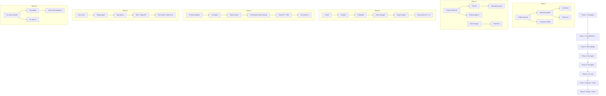

# Ojas: Implementation Plan

| Item | Detail |
|---|---|
| Related documents | All project documents (01 through 08) |
| Duration | 40 days (22 Oct – 30 Nov 2026) |
| Team | 4 members |
| Phases | 8 phases, sequential with parallel tracks within each phase |

---

## Overview

This document breaks the entire Ojas build into **8 phases**. Each phase lists the exact files to create, the logic to implement, verification steps, and dependencies on prior phases. Phases are sequential — each depends on the previous one — but tasks within a phase can run in parallel across team members.

```
Phase 1 ─► Phase 2 ─► Phase 3 ─► Phase 4 ─► Phase 5 ─► Phase 6 ─► Phase 7 ─► Phase 8
Foundation   Core       RAG        Dev Agent  Test Agent Fix Loop   Reports    Final
& Scaffold   Backend    Pipeline   + CodeGen  + Pytest   + Orch.    + Polish   Testing
             + UI Shell                                                        & Demo
```

---

---

## Phase 1: Foundation & Project Scaffolding

**Duration:** 5 days (Oct 22 – 26)
**Goal:** Working dev environment, model loads, both servers start, empty UI renders.

---

### 1.1 Project Structure Creation

Create the complete folder tree and all `__init__.py` files.

**Files to create:**

```
ojas/
├── backend/
│   ├── app/
│   │   ├── __init__.py
│   │   ├── main.py                    ← FastAPI app entry point
│   │   ├── config.py                  ← Settings loader
│   │   ├── api/
│   │   │   ├── __init__.py
│   │   │   └── health.py              ← GET /api/health
│   │   ├── schemas/
│   │   │   ├── __init__.py
│   │   │   └── common.py              ← Error response schema
│   │   ├── tasks/
│   │   │   └── __init__.py
│   │   ├── events/
│   │   │   └── __init__.py
│   │   ├── agents/
│   │   │   ├── __init__.py
│   │   │   └── prompts/
│   │   ├── llm/
│   │   │   ├── __init__.py
│   │   │   ├── client.py              ← LLMClient interface (abstract)
│   │   │   └── llama_cpp_client.py    ← llama.cpp implementation
│   │   ├── rag/
│   │   │   └── __init__.py
│   │   ├── validation/
│   │   │   └── __init__.py
│   │   └── storage/
│   │       ├── __init__.py
│   │       └── db.py                  ← Database init, connection helper
│   └── tests/
│       ├── __init__.py
│       └── test_health.py             ← First API test
├── frontend/                           ← Created by Vite scaffold
├── runtime/                            ← venv created here
├── models/                             ← GGUF file placed here
├── data/                               ← Created at runtime
├── workspace/
├── logs/
├── reports/
├── config/
│   └── settings.json                  ← Default settings
├── docs/
├── requirements.txt
├── start.bat
├── .gitignore
└── README.md
```

**Implementation details:**

#### `backend/app/main.py`
```python
# - Create FastAPI app instance
# - Load settings from config/settings.json via config.py
# - Initialize SQLite database (create tables if not exist)
# - Load LLM model (in a startup event, with error handling)
# - Include API routers
# - Mount frontend/dist as static files (if directory exists)
# - Add CORS middleware (dev mode only)
# - Bind to 127.0.0.1 only
```

#### `backend/app/config.py`
```python
# - Pydantic BaseSettings class: OjasSettings
# - Fields: model_path, n_ctx, n_threads, n_batch, n_gpu_layers,
#           max_tokens, temperature, iteration_limit, test_timeout,
#           host, port, log_level, theme
# - Load from config/settings.json with fallback defaults
# - Singleton access: get_settings()
```

#### `backend/app/llm/client.py`
```python
# - Abstract base class: LLMClient
# - Methods: generate(prompt, max_tokens, temperature, stop) -> str
#            stream(prompt, max_tokens, temperature, stop) -> Iterator[str]
#            is_loaded() -> bool
#            get_info() -> dict
```

#### `backend/app/llm/llama_cpp_client.py`
```python
# - Concrete implementation using llama-cpp-python
# - Load model once in __init__
# - Threading lock for one-generation-at-a-time
# - Implement generate() using create_chat_completion
# - Implement stream() using create_chat_completion with stream=True
# - Track load time, last error
```

#### `backend/app/storage/db.py`
```python
# - get_db_path() -> str
# - get_connection() -> sqlite3.Connection (with WAL, FK, busy_timeout)
# - init_database() -> create all tables from 05_Database_Schema.md
# - Helper: execute_query(), fetch_one(), fetch_all()
```

#### `backend/app/api/health.py`
```python
# - GET /api/health
# - Returns: status, model_loaded, model_name, load_time, version, paths, last_error
```

---

### 1.2 Frontend Scaffold

**Steps:**
1. Run `npm create vite@latest frontend -- --template react-ts` in the project root.
2. Install all dependencies from `04_Technology_Stack.md` §2.
3. Configure `vite.config.ts` with `/api` proxy to `http://127.0.0.1:8000`.
4. Configure Monaco Editor for offline loading (no CDN).
5. Set up Tailwind CSS.
6. Create the App shell with React Router (4 routes: Projects, Workspace, Reports, Settings).
7. Add the top navigation bar with model status chip.

**Files to create:**
```
frontend/src/
├── main.tsx                    ← React DOM render, providers
├── App.tsx                     ← Router setup
├── app/
│   ├── router.tsx              ← Route definitions
│   ├── providers.tsx           ← QueryClient, theme provider
│   └── theme.ts                ← Light/dark theme tokens
├── components/
│   └── shared/
│       ├── AppShell.tsx        ← Top nav bar, outlet, model status chip
│       ├── StatusChip.tsx      ← Coloured status indicator
│       └── EmptyState.tsx      ← "Nothing here yet" component
├── pages/
│   ├── ProjectsPage.tsx        ← Placeholder
│   ├── WorkspacePage.tsx       ← Placeholder
│   ├── ReportsPage.tsx         ← Placeholder
│   └── SettingsPage.tsx        ← Placeholder
├── api/
│   ├── client.ts               ← Base fetch wrapper with error handling
│   └── types.ts                ← TypeScript interfaces matching Pydantic schemas
├── store/
│   └── uiStore.ts              ← Zustand store for UI state
└── monaco/
    └── loader.ts               ← Monaco offline loader config
```

---

### 1.3 start.bat and Runtime Setup

- Create `start.bat` per `08_Setup_Guide.md` §7.3.
- Create `requirements.txt` with pinned versions.
- Create `.gitignore`.
- Create `README.md` with brief setup instructions.

---

### 1.4 Model Download and Verification

- Download `qwen2.5-coder-3b-instruct-q4_k_m.gguf` into `models/`.
- Download `bge-small-en-v1.5` embedding model (run fastembed once online).
- Run verification scripts from `08_Setup_Guide.md` §4.2 and §4.3.
- Record benchmark: tokens/second with `llama-bench`.

---

### ✅ Phase 1 Verification

| Check | How |
|---|---|
| Backend starts | `uvicorn backend.app.main:app --host 127.0.0.1 --port 8000` → no errors |
| Health endpoint | `GET http://127.0.0.1:8000/api/health` → returns model status JSON |
| Model loads | Health response shows `"model_loaded": true` |
| Frontend starts | `cd frontend && npm run dev` → browser shows app shell with navigation |
| Navigation works | Click Projects / Workspace / Reports / Settings → routes change |
| Monaco renders | Add a test Monaco editor in WorkspacePage → editor appears, no CDN errors |
| Database created | `data/ojas.db` exists with all tables |
| start.bat | Double-click → Uvicorn starts, browser opens |

---

---

## Phase 2: Core Backend + Frontend UI Shell

**Duration:** 5 days (Oct 27 – 31)
**Goal:** Project CRUD works end-to-end, file API works, workspace layout is functional.
**Depends on:** Phase 1

---

### 2.1 Backend — Project CRUD

**Files to create/modify:**

| File | Implementation |
|---|---|
| `api/projects.py` | Router: `GET /api/projects`, `POST /api/projects`, `GET /api/projects/{id}`, `PATCH /api/projects/{id}`, `DELETE /api/projects/{id}` |
| `schemas/projects.py` | `ProjectCreate`, `ProjectUpdate`, `ProjectResponse`, `ProjectListResponse` |
| `storage/project_store.py` | `create_project()`, `get_project()`, `list_projects()`, `update_project()`, `delete_project()` — all SQLite operations |

**Logic:**
- Create project → generate UUID, create `workspace/<project_id>/` directory, insert into `projects` table.
- Delete project → delete DB records (CASCADE), delete `workspace/<project_id>/` directory, delete `reports/<project_id>/`.
- Update project → only `name` and `description` are editable. Update `updated_at`.
- List projects → join with aggregate counts (documents, runs, tests).

---

### 2.2 Backend — File API

**Files to create/modify:**

| File | Implementation |
|---|---|
| `api/files.py` | Router: `GET .../files` (tree), `GET .../files/{path}`, `PUT .../files/{path}`, `DELETE .../files/{path}` |
| `schemas/files.py` | `FileNode`, `FileTreeResponse`, `FileContentResponse`, `FileSaveRequest` |
| `storage/file_store.py` | `get_file_tree()`, `read_file()`, `write_file()`, `delete_file()`, `path_is_safe()` |

**Logic:**
- `path_is_safe()` — resolve the path and confirm it stays within `workspace/<project_id>/`. Reject `..`, absolute paths, symlinks.
- `get_file_tree()` — walk `workspace/<project_id>/` recursively, return nested tree structure.
- `read_file()` — read content, detect language from extension, check if generated.
- `write_file()` — create parent directories if needed, write content, update timestamp.

---

### 2.3 Backend — Settings and Config API

**Files to create/modify:**

| File | Implementation |
|---|---|
| `api/settings.py` | Router: `GET /api/settings`, `PUT /api/settings` |
| `schemas/settings.py` | `SettingsResponse`, `SettingsUpdateRequest` |

**Logic:**
- GET → return current settings from the loaded config.
- PUT → validate new values, update `config/settings.json`, update in-memory config. Flag `model_reload_required` if model-related settings changed.

---

### 2.4 Backend — Background Task Manager

**Files to create:**

| File | Implementation |
|---|---|
| `tasks/task_manager.py` | `TaskManager` class: `submit(task_fn)`, `get_status(run_id)`, `cancel(run_id)`, `is_busy()` |
| `events/event_bus.py` | `EventBus` class: `publish(event_type, data)`, `subscribe(run_id) -> AsyncGenerator` |

**Logic:**
- TaskManager runs tasks in a `ThreadPoolExecutor(max_workers=1)`.
- Only one task at a time. New submissions while busy return 409.
- Cancel sets a threading Event that the task checks periodically.
- EventBus uses `asyncio.Queue` per subscriber for SSE streaming.

---

### 2.5 Frontend — Projects Page

**Files to create:**

| File | Implementation |
|---|---|
| `pages/ProjectsPage.tsx` | Full projects page with list and create dialog |
| `components/projects/ProjectCard.tsx` | Card: name, status chip, dates, open/delete buttons |
| `components/projects/NewProjectDialog.tsx` | Modal: name input, description, create button |
| `components/shared/ConfirmDialog.tsx` | Reusable confirmation modal |
| `api/projects.ts` | `listProjects()`, `createProject()`, `deleteProject()`, `getProject()` |

**Logic:**
- Use TanStack Query for data fetching and cache invalidation.
- Project cards in a responsive grid.
- Delete shows confirmation dialog.
- "Open" navigates to `/workspace/<project_id>`.

---

### 2.6 Frontend — Workspace Layout

**Files to create:**

| File | Implementation |
|---|---|
| `pages/WorkspacePage.tsx` | Main workspace with resizable panels |
| `components/workspace/Sidebar.tsx` | Left sidebar with tabs: Docs, Code, Tests |
| `components/workspace/FileTree.tsx` | Recursive file tree from API |
| `components/editor/EditorTabs.tsx` | Tabbed interface for open files |
| `components/editor/CodeEditor.tsx` | Monaco editor wrapper |
| `components/workspace/RunPanel.tsx` | Right panel placeholder (prompt box + buttons) |
| `components/workspace/BottomPanel.tsx` | Bottom panel with tabs: Logs, Tests, Bugs, Model |

**Logic:**
- Use `react-resizable-panels` for the 4-region layout (sidebar | editor | run panel, bottom panel).
- FileTree fetches from `GET /api/projects/{id}/files`.
- Clicking a file opens it in a new editor tab.
- CodeEditor uses the offline Monaco setup from Phase 1.
- Ctrl+S in the editor saves via `PUT /api/projects/{id}/files/{path}`.

---

### ✅ Phase 2 Verification

| Check | How |
|---|---|
| Create project | UI → New Project → project appears in list |
| Open project | Click Open → Workspace page with correct project context |
| File tree | Create files via API → tree shows them |
| Edit file | Open file → edit in Monaco → Ctrl+S → reload confirms save |
| Delete file | Right-click delete → file removed |
| Path safety | `PUT .../files/../../etc/passwd` → 400 error |
| Settings | Settings page → change temperature → verify `settings.json` updated |
| API tests | `pytest backend/tests/` → all pass |

---

---

## Phase 3: Document Ingestion & RAG Pipeline

**Duration:** 5 days (Nov 01 – 05)
**Goal:** Upload documents → parse → chunk → embed → index → search returns relevant chunks.
**Depends on:** Phase 2

---

### 3.1 Document Parser

**File:** `backend/app/rag/parser.py`

```python
# Functions:
# - parse_document(file_path: str, file_type: str) -> str
#     Routes to the correct parser based on file_type.
#
# - parse_docx(file_path: str) -> str
#     Uses python-docx to extract all paragraphs and tables.
#
# - parse_pdf(file_path: str) -> str
#     Uses pypdf to extract text page by page.
#
# - parse_txt(file_path: str) -> str
#     Plain file read with encoding detection.
```

---

### 3.2 Chunker

**File:** `backend/app/rag/chunker.py`

```python
# Functions:
# - chunk_document(text: str, document_id: str) -> list[Chunk]
#     Splits document text into requirement-sized chunks.
#
# Strategy:
#   1. Split by headings (##, ###, numbered sections).
#   2. If a section is > 400 tokens, split further at paragraph boundaries.
#   3. If a section is < 100 tokens, merge with the next section.
#   4. Assign REQ-IDs sequentially: REQ-001, REQ-002, ...
#   5. Each chunk gets: id, req_id, heading, content, token_count, chunk_index.
#
# - chunk_code(file_path: str, source_code: str) -> list[CodeChunk]
#     Uses ast.parse to split Python code into function/class chunks.
#     Each chunk gets: symbol_name, symbol_type, content, start_line, end_line.
```

---

### 3.3 Embedder

**File:** `backend/app/rag/embedder.py`

```python
# Class: Embedder
# - __init__(): Load fastembed TextEmbedding("BAAI/bge-small-en-v1.5")
# - embed_texts(texts: list[str]) -> list[list[float]]
# - embed_single(text: str) -> list[float]
#
# Singleton pattern: loaded once at startup, reused.
# Embedding dimension: 384 (bge-small-en-v1.5).
```

---

### 3.4 Index Manager

**File:** `backend/app/rag/index.py`

```python
# Class: IndexManager
# - __init__(project_id): Initialize Chroma client, get/create collections.
# - index_document(document_id, chunks):
#     1. Delete old chunks for this document_id from SQLite and Chroma.
#     2. Insert new chunks into SQLite (chunks table).
#     3. Embed chunk texts.
#     4. Upsert embeddings + metadata into Chroma 'requirements' collection.
#     5. Update FTS5 index (via triggers).
#     6. Update document status to 'indexed'.
#
# - index_code(file_path, code_chunks):
#     1. Delete old code chunks for this file from SQLite and Chroma.
#     2. Insert into code_chunks table.
#     3. Embed and upsert into Chroma 'code' collection.
#
# - rebuild_chroma():
#     Read all chunks from SQLite, re-embed, re-insert into Chroma.
#
# Chroma config:
#   - chroma_client = chromadb.PersistentClient(path="data/chroma")
#   - Settings(anonymized_telemetry=False)
```

---

### 3.5 Search

**File:** `backend/app/rag/search.py`

```python
# Class: SearchEngine
# - search(project_id, query, top_k=6, collection='requirements') -> list[SearchResult]
#     1. Semantic search: embed query → Chroma query → top 2*k results with scores.
#     2. Keyword search: FTS5 query on chunks_fts → top 2*k results with BM25 rank.
#     3. Reciprocal Rank Fusion:
#        score(doc) = sum(1 / (k + rank)) for each list the doc appears in.
#        k = 60 (standard RRF constant).
#     4. Return top_k merged results.
#
# - SearchResult: chunk_id, req_id, heading, content, score, source (semantic/keyword/both)
```

---

### 3.6 Backend — Document & Index APIs

**Files to create:**

| File | Implementation |
|---|---|
| `api/documents.py` | `POST .../documents` (upload), `GET .../documents` (list), `DELETE .../documents/{id}` |
| `api/requirements_api.py` | `GET .../requirements` (list chunks with REQ-IDs) |
| `schemas/documents.py` | `DocumentUploadResponse`, `DocumentListResponse`, `RequirementChunkResponse` |
| `storage/document_store.py` | CRUD operations for documents table |

**Upload flow:**
1. Receive multipart file(s).
2. Validate file type (docx, pdf, txt only).
3. Compute SHA-256 hash.
4. If hash matches existing document → skip (already indexed).
5. Save file to `workspace/<project_id>/documents/`.
6. Insert into `documents` table with status `uploaded`.
7. Return response.

**Index trigger — `POST .../index`:**
1. Create a background task via TaskManager.
2. For each document with status `uploaded` or hash changed:
   a. Parse document text.
   b. Chunk into requirements.
   c. Embed chunks.
   d. Index into SQLite + Chroma.
   e. Update document status to `indexed`.
3. Publish SSE events: `stage: indexing`, `file: <filename>`, `done`.

---

### 3.7 Frontend — Documents Panel

**Files to create:**

| File | Implementation |
|---|---|
| `components/workspace/DocsPanel.tsx` | Upload area + document list + requirement chunks |
| `components/workspace/UploadArea.tsx` | Drag-and-drop file upload zone |
| `components/workspace/RequirementList.tsx` | Expandable list of REQ-IDs with snippets |
| `api/documents.ts` | `uploadDocuments()`, `listDocuments()`, `listRequirements()`, `triggerIndex()` |

---

### ✅ Phase 3 Verification

| Check | How |
|---|---|
| Upload works | Drag a PDF into Docs panel → document appears in list |
| Parse works | Check logs: text extracted without errors |
| Chunks created | `GET .../requirements` → returns REQ-ID chunks with content |
| Search works | Query "add book" → returns relevant requirement chunks |
| Hash skip | Upload same file again → "already indexed", no reprocessing |
| Changed file | Modify and re-upload → old chunks removed, new chunks indexed |
| FTS5 works | Keyword search for exact terms returns results |
| RRF merge | Results include both semantic and keyword matches |

---

---

## Phase 4: Development Agent & Code Generation

**Duration:** 5 days (Nov 06 – 10)
**Goal:** User enters a prompt → Development Agent generates a plan → user approves → code files generated.
**Depends on:** Phase 3

---

### 4.1 Prompt Templates

**Directory:** `backend/app/agents/prompts/`

| File | Purpose |
|---|---|
| `requirement_analysis.txt` | System prompt for analyzing requirements and creating a structured summary |
| `development_plan.txt` | System prompt for creating a module/file/order plan from requirements |
| `code_generation.txt` | System prompt for generating one Python file at a time, given the plan and relevant requirements |
| `code_fix.txt` | System prompt for fixing a specific function given a bug report and the requirement |

**Prompt design principles:**
- Each prompt includes: system message (role + rules), retrieved requirement chunks, and user instruction.
- Output format is specified (JSON for plan, Python code in code blocks).
- Keep total prompt under 3000 tokens to leave room for generation.
- Include examples of expected output format.

---

### 4.2 Development Agent

**File:** `backend/app/agents/development_agent.py`

```python
# Class: DevelopmentAgent
#
# - __init__(llm_client, search_engine, project_id)
#
# - analyze_requirements(prompt: str) -> RequirementAnalysis:
#     1. Retrieve top requirements relevant to the prompt.
#     2. Build prompt with requirement_analysis template.
#     3. Generate → parse structured analysis (modules, entities, relationships).
#
# - generate_plan(prompt: str, analysis: RequirementAnalysis) -> DevelopmentPlan:
#     1. Build prompt with development_plan template + analysis.
#     2. Generate → parse plan (list of files, order, description of each).
#     3. Return plan for user review.
#
# - generate_file(file_spec: FileSpec, plan: DevelopmentPlan) -> GeneratedFile:
#     1. Retrieve requirements relevant to this specific file/module.
#     2. Build prompt with code_generation template + requirements + plan context.
#     3. Generate → extract Python code from response.
#     4. Return file path + content.
#
# - fix_function(bug_report: BugReport, current_code: str) -> str:
#     1. Retrieve the linked requirement.
#     2. Build prompt with code_fix template + bug details + current code.
#     3. Generate → extract fixed function code.
#     4. Return fixed code.
#
# Helper methods:
# - _extract_code_block(response: str) -> str: Parse ```python blocks from LLM output.
# - _build_context(chunks: list) -> str: Format retrieved chunks into prompt context.
```

---

### 4.3 Static Checker

**File:** `backend/app/validation/static_check.py`

```python
# Functions:
#
# - check_syntax(code: str, file_path: str) -> CheckResult:
#     Try ast.parse(code). Return pass/fail with error details.
#
# - check_lint(file_path: str) -> CheckResult:
#     Run ruff as subprocess on the file.
#     Parse output for errors (not warnings).
#     Return pass/fail with issues list.
#
# - check_file(code: str, file_path: str) -> CheckResult:
#     Run check_syntax then check_lint.
#     If syntax fails, don't run lint.
#     Return combined result.
#
# CheckResult: passed (bool), issues (list of {line, col, code, message})
```

**Self-correction loop (within Development Agent):**
1. Generate code.
2. Run `check_file()`.
3. If failed: append errors to prompt, re-generate (max 2 retries).
4. If still failed after retries: save file with errors noted, continue.

---

### 4.4 Orchestrator — Plan & Develop Flow

**File:** `backend/app/orchestrator.py`

```python
# Class: Orchestrator
#
# - __init__(llm_client, search_engine, task_manager, event_bus)
#
# - run_plan(project_id, prompt) -> RunResult:
#     1. Publish event: stage=planning, status=started.
#     2. Create DevelopmentAgent.
#     3. Analyze requirements.
#     4. Generate development plan.
#     5. Save plan to runs table (plan_text).
#     6. Publish event: stage=planning, status=completed.
#     7. Wait for user approval (plan status = pending_approval).
#
# - run_develop(project_id, prompt, plan) -> RunResult:
#     1. If no approved plan exists, run plan first.
#     2. For each file in the plan (in order):
#        a. Publish event: stage=generating, file=<path>.
#        b. Generate file via DevelopmentAgent.
#        c. Run static checks.
#        d. If checks fail: self-correct (up to 2 retries).
#        e. Write file to workspace.
#        f. Index code chunks.
#        g. Publish event: file=<path>, status=created, check_result.
#     3. Publish event: stage=generating, status=completed.
#
# State machine states:
#   IDLE → PLANNING → PLAN_REVIEW → GENERATING → CHECKING → DONE/FAILED
#
# Cancel check: between each file, check if cancel was requested.
```

---

### 4.5 Backend — Runs API & SSE

**Files to create/modify:**

| File | Implementation |
|---|---|
| `api/runs.py` | `POST .../runs` (start), `GET .../runs` (history), `GET /api/runs/{id}` (detail), `POST /api/runs/{id}/cancel` |
| `api/plan.py` | `GET .../plan` (get plan), `POST .../plan/approve` (approve + proceed) |
| `api/sse.py` | `GET /api/runs/{id}/events` → SSE stream from EventBus |
| `schemas/runs.py` | `RunCreateRequest`, `RunResponse`, `RunDetailResponse`, `RunStepResponse` |

---

### 4.6 Frontend — Run Panel & SSE Listener

**Files to create:**

| File | Implementation |
|---|---|
| `components/workspace/RunPanel.tsx` | Full run panel: prompt box, buttons, status, stage stepper |
| `components/workspace/StageStepper.tsx` | Visual stepper: Index → Plan → Generate → Check → Test → Fix → Done |
| `components/workspace/PlanReview.tsx` | Show plan text, allow editing, Approve button |
| `components/workspace/LogView.tsx` | Live log display with timestamps |
| `api/runs.ts` | `startRun()`, `cancelRun()`, `listRuns()`, `getRunDetail()` |
| `api/sse.ts` | `subscribeToEvents(runId)` → EventSource wrapper with reconnect |
| `store/runStore.ts` | Zustand store for current run state (stage, file, iteration, events) |

**SSE integration:**
1. When a run starts, open EventSource to `GET /api/runs/{id}/events`.
2. On each event, update the Zustand run store.
3. Components subscribe to store slices they need (RunPanel → stage, LogView → events).
4. On `done` event, invalidate TanStack Query caches (files, runs, etc.).

---

### ✅ Phase 4 Verification

| Check | How |
|---|---|
| Plan generation | Enter prompt → Plan appears in PlanReview component |
| Plan edit | Edit plan text → Approve → modified plan used for generation |
| Code generation | Files appear in workspace one by one |
| Static checks | Each file passes ast.parse and ruff (check logs) |
| Self-correction | Introduce a deliberate error in prompt → agent retries and fixes |
| SSE events | Run panel shows live progress: stage, current file |
| Log view | Bottom panel Logs tab shows timestamped events |
| Cancel | Click Stop during generation → run stops cleanly |
| File tree update | After generation, tree shows new files |
| Edit generated code | Open generated file in Monaco → edit → save works |

---

---

## Phase 5: Testing Agent & Validation

**Duration:** 5 days (Nov 11 – 15)
**Goal:** Tests execute with pytest, failures produce structured bug reports with traceability.
**Depends on:** Phase 4

---

### 5.1 Test Runner

**File:** `backend/app/validation/test_runner.py`

```python
# Class: TestRunner
#
# - run_tests(project_id: str, test_timeout: int = 60) -> TestRunResult:
#     1. Determine workspace path: workspace/<project_id>/
#     2. Find all pytest files (test_*.py or *_test.py).
#     3. Run pytest as subprocess:
#        subprocess.run(
#            [sys.executable, "-m", "pytest", "--tb=short", "--junitxml=result.xml", "-v"],
#            cwd=workspace_path,
#            timeout=test_timeout,
#            capture_output=True
#        )
#     4. Parse the JUnit XML report.
#     5. Return per-test results: tc_id, name, result, duration, error_message.
#
# - parse_junit_xml(xml_path: str) -> list[TestCaseResult]:
#     Parse <testcase> elements, extract name, time, <failure>/<error> messages.
```

---

### 5.2 Testing Agent

**File:** `backend/app/agents/testing_agent.py`

```python
# Class: TestingAgent
#
# - __init__(llm_client, search_engine, project_id)
#
# - analyze_failures(test_results: list, code_chunks: list, requirements: list) -> list[BugReport]:
#     For each failed test:
#     1. Find the linked requirement (from tc_id → req_id mapping or search).
#     2. Find the relevant code chunk (from file_path + function_name).
#     3. Build prompt: "Given this requirement, this code, and this test failure,
#        fill in: expected_result, actual_result, probable_cause, severity."
#     4. Generate → parse structured bug report.
#     5. Assign bug_id: B-001, B-002, ...
#
# - propose_tests(requirements: list) -> list[ProposedTest]:
#     (Optional, Could priority)
#     Suggest additional test cases from uncovered requirements.
#
# Bug report fields filled by LLM:
#   - probable_cause (analysis of why it failed)
#   - severity (critical/high/medium/low)
# Bug report fields filled by code:
#   - bug_id, req_id, tc_id, file_path, function_name
#   - expected_result (from test assertion), actual_result (from pytest output)
```

**Prompt template:** `backend/app/agents/prompts/bug_analysis.txt`

---

### 5.3 Test Case Management

**Files to create:**

| File | Implementation |
|---|---|
| `api/tests.py` | `POST .../tests` (upload test files), `GET .../tests` (list test cases), `GET .../tests/{id}/results` |
| `schemas/tests.py` | `TestCaseResponse`, `TestResultResponse`, `TestCaseListResponse` |
| `storage/test_store.py` | CRUD for test_cases and test_results tables |

**Upload flow:**
1. Receive pytest file(s) via multipart upload.
2. Save to `workspace/<project_id>/tests/`.
3. Parse file with `ast` to extract test function names.
4. Assign TC-IDs: TC-001, TC-002, ...
5. Insert into `test_cases` table.

---

### 5.4 Bug Report Storage & API

**Files to create:**

| File | Implementation |
|---|---|
| `api/bugs.py` | `GET .../bugs` (list), `GET .../bugs/{id}` (detail) |
| `schemas/bugs.py` | `BugReportResponse`, `BugListResponse` |
| `storage/bug_store.py` | CRUD for bug_reports table |

---

### 5.5 Orchestrator — Test Flow

**Add to `orchestrator.py`:**

```python
# - run_test(project_id) -> RunResult:
#     1. Publish event: stage=testing, status=started.
#     2. Load test cases for the project.
#     3. Run TestRunner.run_tests().
#     4. Save test results to SQLite.
#     5. If failures exist:
#        a. Create TestingAgent.
#        b. Analyze failures → generate bug reports.
#        c. Save bug reports to SQLite.
#     6. Publish events: test results, bug reports.
#     7. Publish event: stage=testing, status=completed.
```

---

### 5.6 Frontend — Test Results & Bug Reports

**Files to create:**

| File | Implementation |
|---|---|
| `components/workspace/TestsPanel.tsx` | Sidebar tab: list test cases, upload area |
| `components/workspace/TestResultsTable.tsx` | Bottom panel tab: TC-ID, name, result (pass/fail icon), duration |
| `components/workspace/BugList.tsx` | Bottom panel tab: bug reports with severity, REQ-ID, TC-ID, cause |
| `components/editor/DiffEditorView.tsx` | Monaco DiffEditor for accept/reject generated changes |
| `api/tests.ts` | `uploadTests()`, `listTests()`, `getTestResults()` |
| `api/bugs.ts` | `listBugs()`, `getBugDetail()` |

**Interactions:**
- Click a test result row → open the test file at the test function.
- Click a bug report → open the source file at the failing function.
- Click REQ-ID in a bug → show the requirement chunk.

---

### ✅ Phase 5 Verification

| Check | How |
|---|---|
| Upload tests | Drag test file into Tests panel → test cases listed with TC-IDs |
| Run tests | Click Test → pytest runs → results appear in bottom panel |
| Pass/fail correct | Results match actual pytest output (not LLM prediction) |
| Bug reports | Failed tests produce structured bug reports with all fields |
| Traceability | Bug report shows REQ-ID, TC-ID, file, function |
| Bug → code | Click bug report → editor opens at the failing function |
| Diff view | Generated code changes shown in Monaco DiffEditor with Accept/Reject |

---

---

## Phase 6: Fix Loop & Full Orchestration

**Duration:** 5 days (Nov 16 – 20)
**Goal:** Automated test → fix → re-test cycle with stop rules. Full end-to-end workflow.
**Depends on:** Phase 5

---

### 6.1 Fix Loop Controller

**Add to `orchestrator.py`:**

```python
# - run_fix_loop(project_id, iteration_limit=5) -> RunResult:
#     iteration = 0
#     previous_failures = set()
#
#     while iteration < iteration_limit:
#         iteration += 1
#         Publish event: iteration=iteration, limit=iteration_limit.
#
#         # 1. Run tests
#         test_results = TestRunner.run_tests(project_id)
#         failures = [t for t in test_results if t.result == 'failed']
#
#         # 2. Stop rule: all tests pass
#         if not failures:
#             Publish event: done, stop_reason=all_passed.
#             return RunResult(success=True, stop_reason='all_passed')
#
#         # 3. Stop rule: same failure repeats
#         current_failure_set = {(f.tc_id, f.error_message) for f in failures}
#         if current_failure_set == previous_failures:
#             Publish event: done, stop_reason=repeated_failure.
#             Escalate to user.
#             return RunResult(success=False, stop_reason='repeated_failure')
#         previous_failures = current_failure_set
#
#         # 4. Generate bug reports
#         bug_reports = TestingAgent.analyze_failures(failures, ...)
#         Save bug reports to DB.
#
#         # 5. Fix each failing function
#         for bug in bug_reports:
#             Publish event: stage=fixing, file=bug.file_path, function=bug.function_name.
#             fixed_code = DevelopmentAgent.fix_function(bug, current_code)
#             Apply fix to file.
#             Run static checks on fixed file.
#             Publish event: file=bug.file_path, status=fixed.
#
#         # 6. Check cancel
#         if cancel_requested:
#             return RunResult(success=False, stop_reason='user_cancelled')
#
#     # 7. Stop rule: iteration limit
#     Publish event: done, stop_reason=iteration_limit.
#     return RunResult(success=False, stop_reason='iteration_limit')
```

---

### 6.2 Full Orchestration Workflow

**Consolidate in `orchestrator.py`:**

```python
# - run_full(project_id, prompt) -> RunResult:
#     """Complete workflow: index → plan → generate → test → fix loop."""
#
#     1. Index documents (if not already indexed).
#     2. Generate plan → wait for user approval.
#     3. Generate code files (with static checks).
#     4. Run fix loop (test → bug report → fix → re-test).
#     5. Generate consolidated report.
#     6. Return final result.
#
# State machine:
#   IDLE → INDEXING → PLANNING → PLAN_REVIEW → GENERATING → CHECKING
#        → TESTING → FIXING → TESTING → ... → DONE / FAILED / ESCALATED
```

---

### 6.3 Traceability Links

**File:** `backend/app/storage/traceability.py`

```python
# Functions:
# - link_req_to_code(project_id, req_id, code_chunk_id)
# - link_req_to_test(project_id, req_id, test_case_id)
# - link_test_to_bug(project_id, test_case_id, bug_report_id)
# - get_coverage(project_id) -> list[CoverageItem]:
#     For each requirement:
#       - Which code symbols implement it.
#       - Which test cases test it.
#       - Which test results (pass/fail).
#       - Any open bugs.
```

---

### 6.4 Run History

**Add to `api/runs.py`:**
- `GET .../runs` → list all runs with type, status, timestamps, iteration count.
- `GET /api/runs/{id}` → full detail with steps.

**Add to `storage/run_store.py`:**
- `save_run()`, `update_run()`, `save_run_step()`, `get_run_history()`.

---

### 6.5 Frontend — Fix Loop UI

**Files to create/modify:**

| File | Implementation |
|---|---|
| `components/workspace/RunPanel.tsx` (update) | Add Fix Loop button, iteration counter, escalation message |
| `components/workspace/IterationStatus.tsx` | Shows: iteration N/5, failing test, fix applied |
| `components/workspace/EscalationBanner.tsx` | "Fix loop stopped: same failure repeated. Review the bug report." with link to code |

**SSE event handling additions:**
- `iteration` event → update iteration counter.
- `bug` event → add to bug list.
- `done` event with `stop_reason=repeated_failure` → show escalation banner.
- `done` event with `stop_reason=all_passed` → show success message.

---

### 6.6 Frontend — Editor Enhancements

**Files to create/modify:**

| File | Implementation |
|---|---|
| `components/editor/DiffEditorView.tsx` (update) | Accept/Reject buttons above diff editor |
| `components/editor/RequirementBadge.tsx` | Small REQ-ID label above functions. Click → show requirement |
| `components/editor/ReadOnlyBanner.tsx` | "Model is writing this file" banner when file is being generated |

**Logic:**
- During generation: file being generated is read-only in the editor.
- After generation: file shows in diff view (old vs new) with Accept/Reject.
- Accept → `POST .../files/{path}/accept` → file saved.
- Reject → `POST .../files/{path}/reject` → reverted to previous version.

---

### ✅ Phase 6 Verification

| Check | How |
|---|---|
| Fix loop starts | Click Fix Loop → iterations begin |
| Stop: all pass | All tests pass → "All tests passed!" message |
| Stop: limit | Set limit to 2, run → stops at iteration 2 |
| Stop: repeat | Same failure twice → escalation banner shown |
| Cancel | Click Stop during fix loop → loop stops cleanly |
| Traceability | REQ-001 → linked to add_book() → linked to TC-001 → linked to B-001 |
| Diff view | After fix, diff shows changed function with Accept/Reject |
| End-to-end | Upload docs → prompt → plan → generate → test → fix → done |

---

---

## Phase 7: Reports, Settings & UI Polish

**Duration:** 5 days (Nov 21 – 25)
**Goal:** Reports page complete, settings page functional, streaming tokens, polished UX.
**Depends on:** Phase 6

---

### 7.1 Report Generator

**File:** `backend/app/storage/report_writer.py`

```python
# Class: ReportWriter
#
# - generate_development_plan_report(project_id, plan) -> str:
#     Format the plan as a Markdown document.
#
# - generate_bug_report(project_id, bugs) -> str:
#     Format all bug reports as a Markdown table with full details.
#
# - generate_test_report(project_id, results) -> str:
#     Format pytest results as Markdown.
#
# - generate_consolidated_report(project_id) -> str:
#     1. Summary: total tests, passed, failed, iterations, time.
#     2. Requirement coverage table:
#        REQ-ID | Heading | Test Cases | Results | Bugs
#     3. Bug history.
#     4. Run history.
#     Save to reports/<project_id>/consolidated_report.md
#
# All reports saved to reports/<project_id>/ directory.
```

---

### 7.2 Reports API

**Files to create:**

| File | Implementation |
|---|---|
| `api/reports.py` | `GET .../reports` (list), `GET .../reports/{name}` (download) |
| `schemas/reports.py` | `ReportListResponse`, `ReportDetailResponse` |

---

### 7.3 Frontend — Reports Page

**Files to create:**

| File | Implementation |
|---|---|
| `pages/ReportsPage.tsx` | Full reports page with project selector |
| `components/reports/ReportSummary.tsx` | Summary bar: tests count, pass/fail, iterations, time |
| `components/reports/CoverageTable.tsx` | Requirement → test cases → results mapping |
| `components/reports/ReportViewer.tsx` | Markdown renderer for report content |
| `components/reports/RunHistory.tsx` | List of past runs with type, status, time |
| `api/reports.ts` | `listReports()`, `getReport()`, `downloadReport()` |

---

### 7.4 Frontend — Settings Page

**Files to create:**

| File | Implementation |
|---|---|
| `pages/SettingsPage.tsx` | Full settings page |
| `components/settings/SettingsForm.tsx` | Form: model path, context, threads, max tokens, temperature, iteration limit |
| `components/settings/HealthCard.tsx` | Card: model loaded, load time, version, paths, last error |
| `components/settings/ThemeToggle.tsx` | Light / Dark / System toggle |
| `api/settings.ts` | `getSettings()`, `updateSettings()` |

---

### 7.5 Token Streaming

**Backend:**
- Update `LLMClient.stream()` to yield tokens one at a time.
- In orchestrator: when generating, publish `token` SSE events.
- Rate-limit token events (batch every ~100ms to avoid flooding).

**Frontend:**
- `components/workspace/ModelOutput.tsx` — bottom panel tab showing streamed raw model text.
- Append tokens as they arrive from SSE.
- Auto-scroll with pause button.

---

### 7.6 UI Polish

| Item | Implementation |
|---|---|
| **Loading states** | Skeleton loaders for projects, file tree, reports. Spinner for model loading |
| **Empty states** | "Upload a document to begin", "No test cases yet", "No reports generated" |
| **Error handling** | Toast notifications for errors. Retry buttons. Error boundaries |
| **Theme** | Dark/light mode with CSS variables from `03_UI_Design.md` §8.2 |
| **Toasts** | Lightweight toast component for success/error/info messages |
| **Unsaved indicator** | Dot on editor tab when file has unsaved changes |
| **Keyboard shortcuts** | Ctrl+S save, Esc close dialogs, keyboard navigation |
| **Backend disconnected banner** | Full-width "Backend not reachable" with retry |
| **Responsive panels** | Min/max sizes on resizable panels. Collapse sidebar button |

---

### ✅ Phase 7 Verification

| Check | How |
|---|---|
| Reports page | Shows summary, coverage table, report content |
| Coverage table | Each REQ-ID shows linked tests and results. Uncovered highlighted |
| Download report | Click download → Markdown file downloaded |
| Settings page | Change temperature → save → verify API reflects change |
| Health card | Shows model loaded, load time, paths |
| Theme toggle | Switch dark/light → all components update |
| Token streaming | Model output tab shows text appearing character by character |
| Loading states | Slow-load scenarios show skeletons, not blank pages |
| Error handling | Kill backend → "Backend not reachable" banner appears |

---

---

## Phase 8: Integration Testing, Bug Fixes & Demo

**Duration:** 5 days (Nov 26 – 30)
**Goal:** All acceptance criteria pass. Platform is stable and demo-ready.
**Depends on:** Phase 7

---

### 8.1 Sample Projects for Testing

Create 3 sample projects with requirement documents and test cases:

| # | Project | Complexity | Documents |
|---|---|---|---|
| 1 | **Calculator** | Simple | 5 requirements (add, subtract, multiply, divide, history) |
| 2 | **Library System** | Medium | 10 requirements (add/remove books, members, issuing, returns, search) |
| 3 | **Student Grade Manager** | Medium | 8 requirements (students, courses, grades, GPA calculation, reports) |

Each project has:
- A requirement document (`.txt` or `.docx`).
- 5–10 pytest test cases.
- Expected output (what a passing project looks like).

---

### 8.2 Acceptance Criteria Testing

| # | Criterion | Test Procedure |
|---|---|---|
| AC-1 | Offline startup | Disable network → `start.bat` → full cycle works |
| AC-2 | RAG retrieval | Index sample doc → query → verify relevant chunks returned |
| AC-3 | Dev Agent generates valid code | Generate Calculator project → all files pass ast.parse + ruff |
| AC-4 | Test Agent produces bug reports | Run tests on a buggy project → bug reports have REQ-ID, TC-ID, all fields |
| AC-5 | Fix loop stop rules | Test each rule: all pass, iteration limit, repeated failure |
| AC-6 | 2/3 projects pass all tests | Run all 3 sample projects → at least 2 reach all tests passing |
| AC-7 | Consolidated report | Report shows requirement coverage table with pass/fail per test |
| AC-8 | Metrics recorded | Check logs: tokens/s, time/stage, RAM, iterations, Recall@k, MRR |

---

### 8.3 Performance Measurement

**File:** `backend/app/metrics.py`

```python
# Record and report:
# - Tokens per second (per generation call and average)
# - Time per stage (indexing, planning, generating, testing, fixing)
# - Peak RAM usage (psutil.Process().memory_info().rss)
# - Fix loop iterations per project
# - Retrieval metrics: Recall@k and MRR (if ground truth available)
#
# Write to logs/metrics.json after each run.
```

---

### 8.4 Bug Fix Priorities

| Priority | Category |
|---|---|
| 1 - Critical | App crashes, data loss, infinite loops, model doesn't load |
| 2 - High | Wrong test results, broken file save, SSE disconnects permanently |
| 3 - Medium | UI glitches, slow performance, missing error messages |
| 4 - Low | Polish: alignment, colours, typos, edge case formatting |

---

### 8.5 Final Checklist

| Item | Status |
|---|---|
| All acceptance criteria pass | ☐ |
| Offline mode verified (network disabled) | ☐ |
| `start.bat` works on a clean machine (after setup) | ☐ |
| No CDN references in frontend build | ☐ |
| No telemetry in Chroma or any library | ☐ |
| No outbound network calls in backend | ☐ |
| README has clear setup instructions | ☐ |
| Settings page shows correct health info | ☐ |
| Reports download correctly as Markdown | ☐ |
| File API rejects path traversal attempts | ☐ |
| Generated code runs only in workspace with timeout | ☐ |
| Logs capture all operations with timestamps | ☐ |
| At least 2/3 sample projects pass end-to-end | ☐ |
| Metrics recorded for all runs | ☐ |

---

### 8.6 Documentation Update

| Document | Update needed |
|---|---|
| `README.md` | Final setup instructions, usage guide, screenshots |
| `requirements.txt` | Pin exact working versions |
| `package.json` | Pin exact working versions |
| `config/settings.json` | Verified default values |
| All docs (01–08) | Any design changes made during implementation |

---

### ✅ Phase 8 Verification

| Check | How |
|---|---|
| Calculator project | Upload → generate → test → all pass (no fix loop needed) |
| Library project | Upload → generate → test → fix loop → all pass within 5 iterations |
| Student Grade project | Upload → generate → test → fix loop → most tests pass |
| Offline | Full test with network disabled |
| Clean machine | Setup from scratch on a teammate's machine |
| Demo | 10-minute walkthrough: create project → upload → generate → test → report |

---

---

## Appendix A: File Creation Order

For quick reference, here is the recommended order to create files across all phases:

### Phase 1 (Day 1–5)
```
1.  config/settings.json
2.  requirements.txt
3.  .gitignore
4.  start.bat
5.  backend/app/__init__.py
6.  backend/app/config.py
7.  backend/app/storage/db.py
8.  backend/app/llm/client.py
9.  backend/app/llm/llama_cpp_client.py
10. backend/app/api/health.py
11. backend/app/schemas/common.py
12. backend/app/main.py
13. frontend/ (Vite scaffold)
14. frontend/src/monaco/loader.ts
15. frontend/src/App.tsx + router + pages (placeholders)
```

### Phase 2 (Day 6–10)
```
16. backend/app/schemas/projects.py
17. backend/app/storage/project_store.py
18. backend/app/api/projects.py
19. backend/app/schemas/files.py
20. backend/app/storage/file_store.py
21. backend/app/api/files.py
22. backend/app/schemas/settings.py
23. backend/app/api/settings.py
24. backend/app/tasks/task_manager.py
25. backend/app/events/event_bus.py
26. frontend/src/api/client.ts + types.ts
27. frontend/src/api/projects.ts
28. frontend/src/pages/ProjectsPage.tsx (full)
29. frontend/src/components/projects/*
30. frontend/src/pages/WorkspacePage.tsx (full layout)
31. frontend/src/components/workspace/FileTree.tsx
32. frontend/src/components/editor/CodeEditor.tsx
```

### Phase 3 (Day 11–15)
```
33. backend/app/rag/parser.py
34. backend/app/rag/chunker.py
35. backend/app/rag/embedder.py
36. backend/app/rag/index.py
37. backend/app/rag/search.py
38. backend/app/schemas/documents.py
39. backend/app/storage/document_store.py
40. backend/app/api/documents.py
41. backend/app/api/requirements_api.py
42. frontend/src/api/documents.ts
43. frontend/src/components/workspace/DocsPanel.tsx
44. frontend/src/components/workspace/UploadArea.tsx
```

### Phase 4 (Day 16–20)
```
45. backend/app/agents/prompts/*.txt
46. backend/app/agents/development_agent.py
47. backend/app/validation/static_check.py
48. backend/app/orchestrator.py (plan + develop)
49. backend/app/schemas/runs.py
50. backend/app/api/runs.py
51. backend/app/api/plan.py
52. backend/app/api/sse.py
53. frontend/src/api/runs.ts + sse.ts
54. frontend/src/store/runStore.ts
55. frontend/src/components/workspace/RunPanel.tsx
56. frontend/src/components/workspace/StageStepper.tsx
57. frontend/src/components/workspace/PlanReview.tsx
58. frontend/src/components/workspace/LogView.tsx
```

### Phase 5 (Day 21–25)
```
59. backend/app/validation/test_runner.py
60. backend/app/agents/prompts/bug_analysis.txt
61. backend/app/agents/testing_agent.py
62. backend/app/schemas/tests.py
63. backend/app/storage/test_store.py
64. backend/app/api/tests.py
65. backend/app/schemas/bugs.py
66. backend/app/storage/bug_store.py
67. backend/app/api/bugs.py
68. backend/app/orchestrator.py (+ test flow)
69. frontend/src/api/tests.ts + bugs.ts
70. frontend/src/components/workspace/TestsPanel.tsx
71. frontend/src/components/workspace/TestResultsTable.tsx
72. frontend/src/components/workspace/BugList.tsx
73. frontend/src/components/editor/DiffEditorView.tsx
```

### Phase 6 (Day 26–30)
```
74. backend/app/orchestrator.py (+ fix loop)
75. backend/app/storage/traceability.py
76. backend/app/storage/run_store.py
77. frontend/src/components/workspace/IterationStatus.tsx
78. frontend/src/components/workspace/EscalationBanner.tsx
79. frontend/src/components/editor/RequirementBadge.tsx
80. frontend/src/components/editor/ReadOnlyBanner.tsx
```

### Phase 7 (Day 31–35)
```
81. backend/app/storage/report_writer.py
82. backend/app/schemas/reports.py
83. backend/app/api/reports.py
84. frontend/src/pages/ReportsPage.tsx
85. frontend/src/components/reports/*
86. frontend/src/pages/SettingsPage.tsx
87. frontend/src/components/settings/*
88. frontend/src/components/workspace/ModelOutput.tsx
89. UI polish: toasts, skeletons, empty states, theme toggle
```

### Phase 8 (Day 36–40)
```
90. test_projects/ (3 sample projects)
91. backend/app/metrics.py
92. Integration tests
93. Bug fixes
94. README.md (final)
95. Documentation updates
```

---

## Appendix B: Dependency Graph



---

## Appendix C: Risk Mitigation per Phase

| Phase | Key Risk | Mitigation |
|---|---|---|
| 1 | llama-cpp-python build fails on Windows | Use pre-built wheels; document exact compiler setup |
| 2 | Monaco offline config is tricky | Test offline mode immediately; have CodeMirror as backup |
| 3 | Chunking quality affects everything | Test with real documents early; tune chunk sizes |
| 4 | LLM generates unparseable code | Strong output format instructions; self-correction loop; ast.parse |
| 5 | pytest subprocess hangs | Strict timeout; kill process tree on timeout |
| 6 | Fix loop doesn't converge | 3 stop rules guarantee termination; repeated-failure detection |
| 7 | Reports look bad | Use Markdown tables; test rendering in react-markdown |
| 8 | 2/3 projects don't pass | More iterations, better prompts, try 7B model as fallback |
